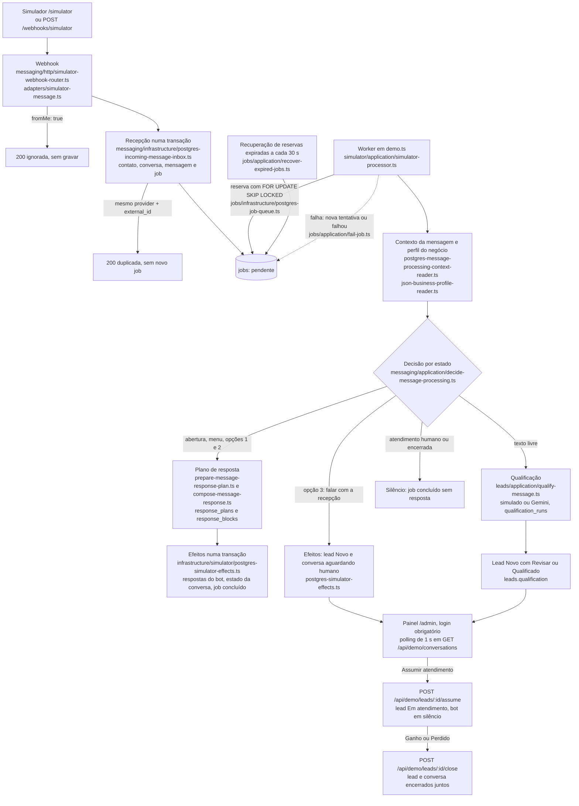
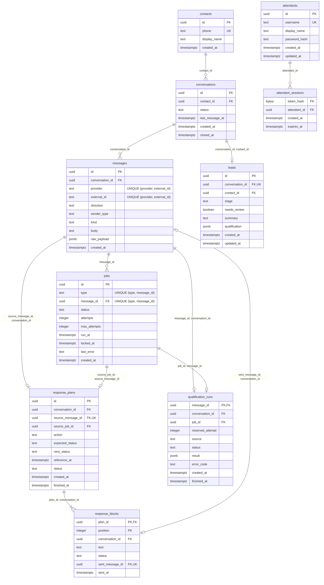

# Copiloto de Leads WhatsApp

## O que é o projeto

Projeto de portfólio e de estudo de arquitetura: a recepção administrativa de uma **clínica fictícia de fisioterapia** recebe mensagens de WhatsApp, responde com textos predefinidos, qualifica cada pedido e organiza os leads num Kanban para os atendentes (D15).

- **O que é simulado:** o WhatsApp. As mensagens chegam por um simulador (`/simulator` ou `POST /webhooks/simulator`), e as respostas do bot são gravadas no banco, sem envio real (D14). Todos os dados são sintéticos. O atendente continua a conversa pelo próprio WhatsApp, com o botão **Abrir no WhatsApp** do painel (D13).
- **O que a IA faz:** só extrai dados administrativos do texto livre: intenção (agendamento ou informações), serviço declarado, período desejado e um resumo. A saída é validada no backend, e cada campo precisa de um trecho literal da conversa como evidência. Faltou evidência, a saída veio inválida ou a chamada falhou: o lead fica em **Novo** com **Revisar** (D8, D12).
- **O que a IA não faz:** não escreve nem escolhe respostas ao cliente, não muda a etapa para Ganho ou Perdido e não faz diagnóstico, indicação de tratamento ou triagem clínica (D8, D15). O nome de perfil do WhatsApp nunca é enviado à IA.
- **Qualificador:** por padrão, um qualificador **simulado**, sem API externa. O adapter Gemini é opcional e só é ativado com `QUALIFIER_PROVIDER=gemini` no backend. Use apenas dados sintéticos com ele.
- **A v1:** texto apenas, um negócio por instalação, painel com login de atendentes e atualização por polling de 1 s (D9 revisada). Não há número real de WhatsApp, envio manual pelo painel, arrastar e soltar cards, nem registro de qual atendente assumiu ou encerrou um lead.

O backend é um monólito modular (D1) num monorepo com npm workspaces (D19):

```text
apps/api          Backend Express, worker do simulador e migrações
apps/web          Simulador, painel Kanban e tela de login (TypeScript e CSS, sem framework)
packages/shared   Tipos públicos dos contratos HTTP usados pela API e pelo painel
docs              Decisões, modelagem e guias de cada entrega
```

## Fluxo

Do webhook do simulador até o painel. Cada etapa corresponde a um arquivo de `apps/api/src`.



O worker conclui o job dentro da mesma transação dos efeitos ou da qualificação; o caso de uso `complete-job.ts` existe, mas não é usado nesse caminho. Mídias (áudio e outros) são gravadas sem criar job. Uma mensagem de um contato com conversa encerrada abre uma nova conversa no mesmo contato (D16).

## Modelagem de dados

Gerado a partir das oito migrações em `apps/api/migrations`, que são a fonte da verdade. Todas as tabelas ficam no schema `public`; a tabela `pgmigrations`, do migrador, fica de fora.



Como ler o diagrama:

- **Chaves estrangeiras compostas:** as relações com dois campos usam FKs compostas, que conferem o vínculo e não só a existência do ID. Por exemplo, um plano de resposta só aponta para uma mensagem da mesma conversa, e o lead aponta para o par conversa e contato. `response_plans.conversation_id` e `leads.contact_id` fazem parte dessas FKs; não há FK direta deles para `conversations` e `contacts`.
- **Unicidades:** `UK` marca só as unicidades de uma coluna. As compostas aparecem como comentário ao lado das colunas:
  - `messages` é única em `(provider, external_id)`, base da idempotência (D5);
  - `jobs` é única em `(type, message_id)`.
- **Índices únicos parciais**, que o diagrama não mostra:
  - no máximo uma conversa aberta por contato;
  - no máximo um lead aberto (Novo, Qualificado ou Em atendimento) por contato;
  - uma abertura e um plano pendente por conversa.
- **Estados:** são `text` com `CHECK`, não enums do PostgreSQL.
- **Exclusão:** todas as FKs usam `ON DELETE RESTRICT`, exceto `attendant_sessions`, apagada em cascata com o atendente.
- **Atendentes:** `attendants` não se liga a leads nem a conversas; o login protege o painel, mas não registra autoria.

**Previsões, sem migração:** `business_profile` (hoje o perfil é o arquivo `apps/api/config/business-profile.json`), `users` (o login implementado usa `attendants`), `ai_extractions` e `lead_events`. Elas aparecem só como proposta no [documento 4](docs/04-modelagem-de-dados.md).

## Rodar localmente

Pré-requisitos:

- Node.js `24.14.1` (registrado em `.nvmrc`; `engines` aceita `>=24.14.1 <25`) e npm `11.11.0`;
- Docker, para o PostgreSQL local do `compose.yaml`.

Na raiz do repositório:

1. `npm ci`
2. Copie `.env.example` para `.env`.
3. No `.env`, preencha `POSTGRES_PASSWORD` com uma senha local qualquer e `DEMO_PASSWORD` com a senha de demonstração abaixo. Deixe `DEMO_USERNAME=demo`.
4. `docker compose up -d postgres`
5. `npm run db:migrate`, que aplica as migrações pendentes no banco do `.env`.
6. `npm run attendant:seed-demo`, que cria o atendente de demonstração ou atualiza a senha dele.
7. `npm run start:demo`, que sobe a API, o worker e as telas em `127.0.0.1`.
8. Abra `http://127.0.0.1:3000/login` (ou a porta de `API_PORT`) e entre com o acesso de demonstração, que também aparece na própria tela de login.

| Acesso de demonstração | Valor |
|---|---|
| Usuário | `demo` |
| Senha | `demo-copilot-leads-2026` |

**A senha desta tabela precisa ser a mesma definida como `DEMO_PASSWORD` no deploy.** Se o `DEMO_PASSWORD` do deploy mudar, atualize esta tabela e rode `npm run attendant:seed-demo` de novo no ambiente do deploy. A tela de login sempre mostra o valor do ambiente. As credenciais são públicas por design e dão acesso só a dados sintéticos; limites e cuidados estão no [documento 35](docs/35-acesso-de-demonstracao.md).

Depois de entrar, use o `/simulator`: envie "Olá", espere o menu e escolha 1, 2 ou 3. Com 1 ou 2, responda em texto livre (por exemplo, "Quero agendar avaliação amanhã à tarde") para ver a qualificação no `/admin`.

Cada ambiente tem o próprio banco. A aplicação depende das migrações aplicadas no banco configurado no `.env`, e o repositório não registra quais já foram aplicadas em cada um.

### Scripts

| Script | Finalidade |
|---|---|
| `npm run check` | Verifica tipos, compila os três pacotes e roda os testes da API e da web que não precisam de banco |
| `npm run test:integration` | Roda as suítes com PostgreSQL; cada uma cria e apaga o próprio banco descartável. Exige o container do banco em execução |
| `npm run start:demo` | Compila os três pacotes e inicia API, worker do simulador e telas; exige as migrações aplicadas |
| `npm run start:api` | Compila a API e inicia só o webhook, sem worker nem telas |
| `npm run simulate:message` | Envia o exemplo versionado ao webhook local; a API precisa estar em outro terminal |
| `npm run db:check` | Testa a conexão da aplicação com o banco do `.env` |
| `npm run db:migrate` | Aplica migrações pendentes no banco do `.env`; altera a estrutura do banco |
| `npm run attendant:create -- <usuario> "<nome>"` | Cria um atendente; a senha é pedida no terminal, com um asterisco por tecla, e confirmada |
| `npm run attendant:set-password -- <usuario>` | Troca a senha do atendente e encerra todas as sessões dele |
| `npm run attendant:seed-demo` | Cria o atendente de demonstração com `DEMO_USERNAME` e `DEMO_PASSWORD`; se ele já existe, troca a senha e encerra as sessões dele |

O servidor só escuta em `127.0.0.1`. Expor o painel fora do loopback exige HTTPS e `SESSION_COOKIE_SECURE=true` (D23). As demais variáveis estão comentadas no `.env.example`.

## Documentação

- [Escopo e requisitos](docs/01-escopo-e-requisitos.md): o que entra e o que fica fora da v1.
- [Decisões de arquitetura](docs/02-decisoes-de-arquitetura.md): D1 a D23, com motivo e trade-off.
- [Fluxo e ciclo de vida](docs/03-fluxo-e-ciclo-de-vida.md), [modelagem de dados](docs/04-modelagem-de-dados.md) e [contratos de dados](docs/05-contratos-de-dados.md).
- [Dependências](docs/06-dependencias-do-projeto.md) e [fluxo de desenvolvimento](docs/07-fluxo-de-desenvolvimento.md).
- Guias de cada etapa, de 08 a 28, em ordem de entrega (base do monorepo, PostgreSQL, migrações, recepção, fila de jobs, perfil, decisão e plano de resposta).
- Funcionalidades:
  - [MVP do simulador](docs/29-mvp-fluxo-simulador.md);
  - [assunção](docs/30-assuncao-de-atendimento-humano.md);
  - [encerramento](docs/31-encerramento-de-leads.md);
  - [qualificação](docs/32-qualificacao-de-leads.md);
  - [login de atendentes](docs/34-login-de-atendentes.md);
  - [acesso de demonstração](docs/35-acesso-de-demonstracao.md).
- [Backlog técnico](docs/33-backlog-tecnico.md): pendências conhecidas.
- [Histórico de etapas](docs/36-historico-de-etapas.md): o registro de cada entrega que antes ficava neste README.
