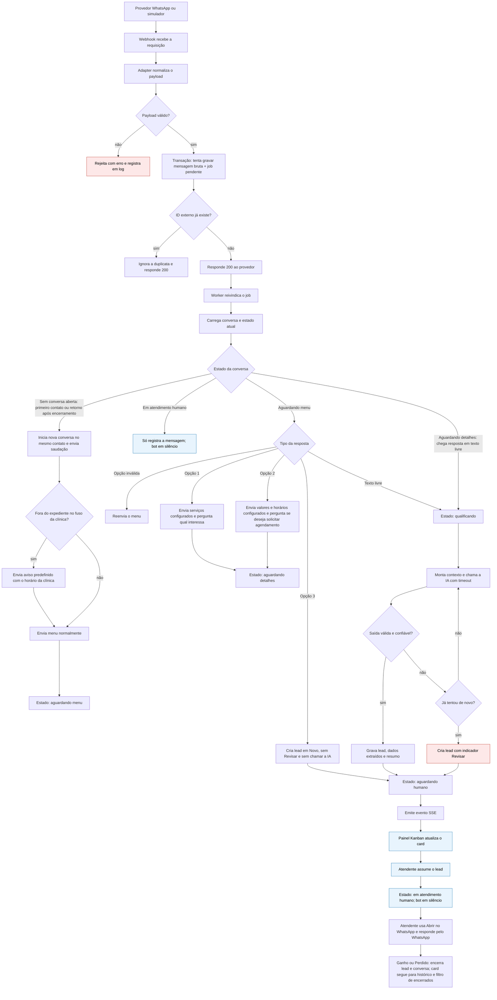

# Copiloto de Leads WhatsApp — 3. Fluxo e Ciclo de Vida da Mensagem

Documento de planejamento · rascunho de 22/10/2026

## 1. Visão geral do fluxo

O diagrama abaixo mostra o caminho de uma mensagem, do webhook até o card no Kanban, incluindo o desvio para o atendimento humano quando a IA falha. A IA só entra depois que a mensagem está gravada, e qualquer falha nela termina no painel com o indicador Revisar.

## 2. Ciclo de vida passo a passo

1. **Chegada.** O provedor de WhatsApp (ou o simulador) envia um webhook ao backend.
2. **Normalização.** O adapter do provedor converte o payload para o formato interno do sistema (decisão D6).
3. **Validação.** Se o payload não tem o formato esperado, a requisição é rejeitada com erro e registrada em log. Nada é gravado.
4. **Gravação em uma única transação.** A mensagem bruta e um job "pendente" são gravados juntos. Se o ID externo da mensagem já existe, a duplicata é ignorada (D5).
5. **Resposta rápida.** O webhook responde 200 ao provedor (D3).
6. **Reivindicação.** O worker pega o próximo job pendente (D4).
7. **Carga de contexto.** O worker carrega a conversa e o estado atual dela. Mensagens do mesmo contato durante um atendimento são vinculadas à única conversa aberta e reutilizam o lead existente; não criam cards adicionais (D16).
8. **Decisão por estado** (veja a tabela da seção 3):
   - Primeiro contato ou retorno sem conversa aberta: inicia uma nova conversa vinculada ao contato e envia saudação e menu predefinidos. Fora do expediente, inclui um aviso com o horário da clínica, calculado no fuso do perfil; o menu e a qualificação continuam normalmente (D17). As conversas anteriores permanecem encerradas no histórico (D16).
   - Atendente já assumiu: apenas registra a mensagem; o bot não responde.
   - Aguardando menu: opções 1 e 2 enviam informações e uma pergunta predefinidas, passando para Aguardando detalhes. A opção 3 cria o lead em Novo, sem indicador Revisar e sem chamar a IA, passando diretamente para Aguardando humano e notificando o painel (passo 12). Opção inválida reenvia o menu; texto livre vai para a qualificação.
   - Aguardando detalhes: a resposta em texto livre alimenta a qualificação.
9. **Qualificação pela IA.** O sistema monta o contexto (mensagens recentes e perfil do negócio), chama o LLM com o schema esperado e um tempo máximo de espera. Na clínica fictícia, a extração é administrativa: intenção, serviço declarado e prazo desejado informado. Não há inferência de tratamento ou urgência clínica (D15). Os cenários da demonstração contêm apenas dados sintéticos.
10. **Validação da saída.** A resposta é validada em runtime (D8). Saída inválida ou com baixa confiança leva ao fallback humano.
11. **Persistência.** O lead, os dados extraídos e o resumo são gravados. A conversa passa para "Aguardando humano".
12. **Notificação do painel.** O backend emite um evento por SSE (D9) e o card aparece no Kanban.
13. **Assunção e atendimento.** O atendente assume o lead no painel. A conversa passa para "Em atendimento humano" e o bot fica em silêncio. O atendente usa o botão **Abrir no WhatsApp** para abrir a conversa com o contato e responder pelo próprio WhatsApp (D13). O painel não envia mensagens manuais na v1.
14. **Encerramento.** O atendente move o lead para Ganho ou Perdido no painel. Lead e conversa são encerrados na mesma transação, e o card sai do Kanban principal, permanecendo acessível pelo filtro de encerrados e pelo histórico do contato. Um retorno posterior inicia outra conversa; o registro anterior permanece encerrado (D16).

O histórico do painel mostra as mensagens registradas pelo sistema. As respostas enviadas diretamente pelo atendente no WhatsApp podem não aparecer nesse histórico, dependendo do provedor.

## 3. Estados da conversa e transições

| Estado | Entra quando | Sai quando | O bot envia mensagem? |
|---|---|---|---|
| Aguardando menu | Primeiro contato ou menu reenviado | Cliente escolhe opção ou escreve texto livre | Sim, apenas texto predefinido; na abertura fora do expediente, inclui aviso de horário (D17) |
| Aguardando detalhes | Cliente escolhe a opção 1 ou 2 e recebe as informações e a pergunta configuradas | Resposta em texto livre segue para qualificação | Apenas as informações e a pergunta predefinidas de entrada no estado |
| Qualificando | Chega texto livre | IA devolve saída válida ou falha de vez | Não |
| Aguardando humano | Lead qualificado, fallback acionado ou opção 3 escolhida sem chamar a IA | Atendente assume | Não |
| Em atendimento humano | Atendente assume o lead | Lead é encerrado | Não |
| Encerrada | Lead movido para Ganho ou Perdido | Não é reaberta por novas mensagens; o retorno inicia outra conversa no mesmo contato | Não |

Transições fora desta tabela devem ser recusadas pelo código. Essa é a utilidade da máquina de estados.

O tempo sem resposta do cliente não é um evento de transição na v1: a conversa preserva seu estado, sem lembretes ou encerramento automático por inatividade (D18).

## 4. Tratamento de falhas

| Falha | O que acontece | Resultado |
|---|---|---|
| Payload inválido | Rejeitado e registrado em log; nenhum dado gravado | Nada entra no sistema |
| Mensagem duplicada | A restrição de unicidade ignora a segunda inserção; responde 200 | Nenhum lead duplicado |
| Banco indisponível no webhook | Responde erro ao provedor, que reenvia depois | A idempotência protege o reenvio |
| Timeout ou erro da IA | Uma nova tentativa; se falhar de novo, aciona o fallback | Lead vai para revisão humana |
| Saída da IA inválida | Mesmo tratamento do timeout | Lead vai para revisão humana |
| Baixa confiança da IA | Lead criado com o indicador Revisar (limiar a definir) | Atendente confere os dados |
| Worker cai no meio do job | Um job "processando" por tempo demais volta para "pendente" | O job é refeito sem duplicar dados |
| Falha ao enviar o menu | Novas tentativas com intervalo crescente; falha final registrada | Problema fica visível nos logs |
| Painel perde a conexão SSE | O navegador reconecta e o painel recarrega a lista | Nenhum evento perdido fica sem correção |

## 5. Princípio do fallback humano

Todo caminho de falha termina em um humano, e nunca em silêncio. Se a IA não entendeu, o lead aparece no Kanban com o indicador **Revisar** e o histórico completo da conversa. O atendente decide o que fazer. Isso é o que torna seguro usar um componente não determinístico no meio do fluxo.

## 6. Menu inicial confirmado

Opções confirmadas em 23/10/2026 para o perfil da clínica fictícia:

| Número | Rótulo | Comportamento |
|---|---|---|
| 1 | Conhecer os serviços | Envia uma apresentação predefinida dos serviços e pergunta qual deles interessa. Aguarda a resposta em texto livre para qualificação. |
| 2 | Consultar valores e horários | Envia valores e horários configurados e pergunta se deseja solicitar um agendamento. Aguarda a resposta em texto livre para qualificação. |
| 3 | Falar com a recepção | Cria o card em Novo, sem indicador Revisar, e coloca a conversa em Aguardando humano, sem chamar a IA. |

Essas opções e seus textos ficam na configuração do negócio, conforme D11. O cliente escolhe pelo WhatsApp; na demonstração inicial, o simulador representa essa interação (D14). O comportamento e as transições acima estão confirmados; os textos finais, serviços, valores e horários da clínica ainda serão definidos.

Nas opções 1 e 2, a IA apenas extrai informações da resposta e do contexto administrativo. Uma solicitação de agendamento não confirma uma reserva: a recepção dá continuidade pelo WhatsApp.

Na opção 3, os campos exclusivos da qualificação por IA permanecem sem preenchimento, sem inventar resumo ou confiança. O painel mostra os dados disponíveis do contato e o histórico registrado. A conversa aguarda a recepção; o bot fica em silêncio. A atribuição a um atendente ocorre quando ele assume o lead no painel.

## 7. Atendimento fora do expediente

Ao iniciar uma conversa fora do expediente, o bot envia o aviso configurado com o horário de atendimento e continua com o menu. A comparação usa o fuso e as faixas do perfil da clínica, sem depender do fuso do servidor (D17).

O aviso faz parte da abertura, sem repetição a cada mensagem. O restante do fluxo permanece igual: as opções 1 e 2 permitem qualificação pela IA; a opção 3 encaminha diretamente à recepção. Os leads ficam disponíveis no painel para o atendimento humano, sem promessa de resposta imediata.

Conversas em **Aguardando humano** ou **Em atendimento humano** continuam com o bot em silêncio, inclusive fora do expediente. A chegada do horário de abertura não altera automaticamente o estado nem atribui um atendente.

## 8. Inatividade do cliente

Conversas abertas não expiram por falta de resposta na v1. O sistema não envia lembretes nem reinicia o menu pelo tempo decorrido. Ao receber nova mensagem, usa a conversa aberta e seu estado atual, reutilizando o lead quando já existir (D16 e D18).

Se a conversa aguardava menu ou detalhes, a resposta segue esse fluxo. Se aguardava a recepção ou estava em atendimento humano, a mensagem é registrada e o bot continua em silêncio. O encerramento de um atendimento com lead permanece sob controle do atendente no painel. Após um encerramento, o retorno inicia um novo ciclo conforme D16.

## 9. Pontos em aberto

- Quais serão os textos finais das mensagens, serviços, valores e horários da clínica fictícia?
