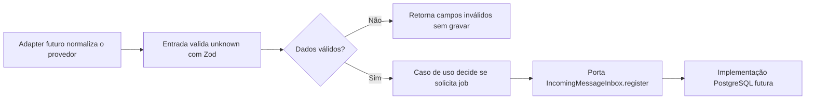

# Etapa 4.7 — Contrato e caso de uso de recepção

Preparada em 05/11/2026 na branch `feat/message-reception-contract`, após publicar a entrega de jobs. Esta é a primeira parte de recepção no módulo `messaging`. O objetivo é revisar a fronteira de validação e a regra de processamento antes de implementar o acesso transacional ao banco.

**Resultado:** `npm run check` passou na tipagem e compilação dos três pacotes e em 16 testes sem banco: seis de configuração, cinco do caso de uso e cinco da entrada. Não foram instaladas dependências nem alterados SQL, credenciais, servidor HTTP ou infraestrutura de integração. Não foi executado `db:migrate`.

## 1. Fluxo para revisão

Revisar os arquivos nesta ordem ajuda a entender quem define um contrato e quem depende dele:

| Ordem | Arquivo | Responsabilidade e dependências |
|---|---|---|
| 1 | [contracts/normalized-message.ts](../apps/api/src/modules/messaging/contracts/normalized-message.ts) | Define o schema com Zod e deriva `NormalizedMessage`; não depende do caso de uso ou do banco |
| 2 | [application/incoming-message-inbox.ts](../apps/api/src/modules/messaging/application/incoming-message-inbox.ts) | Define a porta `IncomingMessageInbox`, seu comando e resultado; importa apenas o tipo normalizado |
| 3 | [application/receive-message.ts](../apps/api/src/modules/messaging/application/receive-message.ts) | Aplica a regra de quais conteúdos devem gerar processamento; usa a porta por parâmetro |
| 4 | [application/receive-message.test.ts](../apps/api/src/modules/messaging/application/receive-message.test.ts) | Verifica a regra com um substituto da porta, incluindo duplicata e erro informado pela persistência |
| 5 | [input/receive-message.ts](../apps/api/src/modules/messaging/input/receive-message.ts) | Valida `unknown`, rejeita dados inválidos e só depois chama o caso de uso |
| 6 | [input/receive-message.test.ts](../apps/api/src/modules/messaging/input/receive-message.test.ts) | Verifica validação, campos extras, texto, mídia e ausência de chamadas em entradas inválidas |
| 7 | [package.json da API](../apps/api/package.json) | Inclui explicitamente os dois arquivos novos no script `test`, sem incluir testes que exigem banco |

No item 1, observe `kind`: ele discrimina as três variantes. O compilador só permite acessar `text` com segurança depois de saber que a mensagem é `texto`. O tipo TypeScript vem do schema; não há uma segunda definição manual da mensagem.

No item 2, observe que a aplicação define a interface de que precisa, sem depender de uma classe PostgreSQL. A futura implementação de infraestrutura obedecerá a essa interface. Não há um repositório genérico para cada tabela: a porta descreve a operação de recepção que precisa ser atômica.

No item 3, acompanhe `enqueueProcessing`: só recebe `true` para texto. A regra pertence ao caso de uso. O SQL futuro receberá essa decisão e executará as gravações necessárias, sem decidir quais mídias a V1 processa.

## 2. Caminho dos dados e direção das dependências



A entrada depende do schema e do caso de uso. O caso de uso conhece a mensagem tipada e a porta de persistência, usando somente `import type` para esses contratos. Não importa `pg`, Express ou Zod em execução. A implementação PostgreSQL será uma dependência fornecida pela composição, como o substituto já é fornecido nos testes. Essa é a inversão de dependência prevista na D2/D22.

O schema fica em `contracts` dentro do módulo backend porque a mensagem normalizada é um contrato interno da recepção, não uma resposta pública do painel. `packages/shared` continua reservado aos contratos públicos entre aplicações.

O `rawPayload` passa separado e opaco como `unknown`. O caso de uso não lê campos específicos do provedor, não registra seu conteúdo em log e não mistura o original com a mensagem normalizada. A futura entrada HTTP e seu adapter cuidarão da forma original; a infraestrutura precisará tratar a serialização para JSONB.

## 3. Comportamento desta entrega

- Texto válido exige `text` não vazio após verificar espaços. O conteúdo original é preservado, incluindo espaços nas pontas.
- `audio` e `outro` não exigem texto. Um campo `text` extra nessas variantes é descartado da representação normalizada.
- Provedor e ID externo exigem conteúdo não vazio e permanecem opacos, sem alteração de valor. Não foi fixada uma lista de provedores no núcleo.
- Telefone precisa chegar canônico, no formato da restrição de `contacts`. Não há conversão de números locais nem suposição de DDI.
- `receivedAt` exige um `Date` válido. Uma string recebida pelo futuro webhook precisará ser validada e convertida pelo adapter conforme o formato desse provedor; não há conversão implícita neste schema.
- Campos extras são removidos da mensagem normalizada; o original separado permanece disponível para a futura persistência.
- Entrada inválida retorna `{ status: "invalida", fields: [...] }`, sem chamar a porta ou retornar os valores que falharam.
- Entrada válida solicita registro. Texto pede processamento; mídia pede apenas registro.
- O resultado `registrada` ou `duplicada`, com `messageId`, vem da porta. Falhas dessa porta propagam; não são convertidas em sucesso ou duplicata.

O caso de uso recebe dados tipados já validados. A entrada interna é o caminho para dados desconhecidos vindos de adapters; não é uma rota Express. A separação permite estudar e testar essas responsabilidades antes de introduzir HTTP.

## 4. O que os testes comprovam

Os cinco testes do caso de uso verificam texto com processamento, áudio sem processamento, outros conteúdos sem processamento, preservação do resultado de duplicata e propagação de erro.

Os cinco testes da entrada verificam validação e descarte de campos extras sem alterar o original, uma matriz de dados inválidos sem chamadas de persistência, resposta de erro limitada a campos, variantes sem texto e encaminhamento do resultado de duplicata.

Os substitutos de `IncomingMessageInbox` apenas capturam comandos ou devolvem resultados controlados. Eles comprovam a decisão da aplicação e a forma como ela reage ao contrato. Não comprovam armazenamento, atomicidade, reutilização de conversa ou idempotência sob concorrência no PostgreSQL.

Para repetir na raiz:

```powershell
npm run check
```

`npm test` também executa os 16 testes sem banco, após compilar a API. Os 42 registros de integração da entrega de jobs já estavam aprovados e não foram repetidos nesta preparação: esta entrega não altera os arquivos que acessam banco nem as migrações.

## 5. Próximo bloco

Após revisar os contratos e a regra, implementar a porta com PostgreSQL. Essa implementação deverá resolver contato e conversa aberta, preservar ciclos encerrados, reconhecer duplicatas e gravar mensagem e eventual job na mesma transação e no mesmo cliente reservado. Os testes de integração deverão comprovar commit, rollback, reenvios e concorrência nessa operação real.

Em seguida, conectar a entrada ao adapter do simulador e ao webhook Express. A conversão de formatos do provedor, a filtragem de mensagens enviadas pelo próprio sistema e os códigos HTTP serão tratados nessa integração. Worker, menu, IA e painel continuam nas respectivas entregas.

A revisão foi concluída pelo autor em 09/11/2026. O contrato e a implementação foram registrados nos commits `d99d743` e `7866eb7`; o script de testes e a documentação complementam a entrega. Nesta conferência, `npm run check` foi executado novamente com 16 testes aprovados. Nenhuma migração foi aplicada ao banco do projeto.
