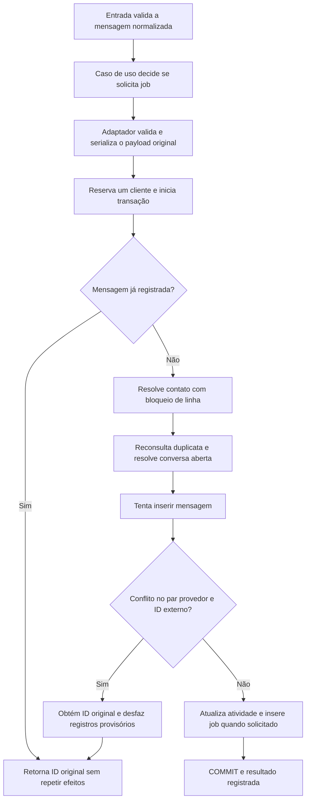

# Etapa 4.8 — Recepção transacional no PostgreSQL

Preparada em 09/11/2026 na branch `feat/postgres-message-reception`, sobre a etapa 4.7 revisada e enviada ao remoto. Implementa a porta `IncomingMessageInbox` já existente. As camadas de entrada e aplicação permanecem iguais; a integração conecta essas camadas à infraestrutura real no banco descartável.

**Validação final:** `npm run check` passou em tipos, compilação e 20 testes sem banco. `npm run test:integration` passou em 55 registros, zero falhas: os 42 anteriores, doze cenários novos e um agrupador. Nenhuma dependência foi instalada, nenhuma migração foi criada ou modificada e `db:migrate` não foi executado no banco do projeto.

## 1. Fluxo de revisão por dependência

| Ordem | Arquivo | O que revisar |
|---|---|---|
| 1 | [application/incoming-message-inbox.ts](../apps/api/src/modules/messaging/application/incoming-message-inbox.ts) — existente | Releia a porta: comando, decisão de enfileirar e resultado de registro ou duplicata. O contrato não precisou mudar |
| 2 | [infrastructure/serialize-message-payload.ts](../apps/api/src/modules/messaging/infrastructure/serialize-message-payload.ts) | Validação do `unknown` como JSON, serialização e erro sem conteúdo original |
| 3 | [serialize-message-payload.test.ts](../apps/api/src/modules/messaging/infrastructure/serialize-message-payload.test.ts) | Quatro testes sem banco para objetos, arrays, primitivos, valores incompatíveis e ciclos |
| 4 | [postgres-incoming-message-inbox.ts](../apps/api/src/modules/messaging/infrastructure/postgres-incoming-message-inbox.ts) | Implementação da porta; pool recebido por construtor, cliente reservado, SQL, conflitos e encerramento da transação |
| 5 | [postgres-incoming-message-inbox.integration.test.ts](../apps/api/src/modules/messaging/infrastructure/postgres-incoming-message-inbox.integration.test.ts) | Preparação isolada, conexão da entrada ao adaptador real, cenários de concorrência e falha na criação do job |
| 6 | [package.json da API](../apps/api/package.json) | Inclusão explícita do teste de serialização e da nova integração nos comandos adequados |
| 7 | [fluxo](03-fluxo-e-ciclo-de-vida.md), [modelagem](04-modelagem-de-dados.md) e [contratos](05-contratos-de-dados.md) | Conferir o vínculo de conversa preparado antes da mensagem e os limites desta implementação |

No arquivo do item 4, acompanhe o método `register` nesta ordem:

1. Serializa o original antes de reservar uma conexão.
2. Reserva um cliente do pool e inicia `READ COMMITTED`.
3. Consulta duplicata antes de fazer gravações.
4. Insere o contato se necessário e bloqueia sua linha com `FOR UPDATE`.
5. Reconsulta duplicata depois de obter esse bloqueio.
6. Busca e bloqueia a conversa aberta, ou cria um novo ciclo com o estado inicial do banco.
7. Tenta inserir a mensagem, tratando apenas o conflito da restrição de provedor e ID externo.
8. Atualiza a última atividade e, quando solicitado pelo caso de uso, cria o job.
9. Confirma a transação; em erro, tenta rollback e propaga a falha.
10. Libera o cliente. Se o rollback falhar, descarta a conexão em vez de devolvê-la ao pool.

## 2. Fluxo executado nesta entrega



O teste passa pela entrada existente e pelo caso de uso, fornecendo `new PostgresIncomingMessageInbox(pool)` como implementação. Ainda não existe uma composição de servidor HTTP. A classe não cria um pool global nem abre conexões ao ser importada ou construída.

## 3. Transação e concorrência

Todas as consultas da operação usam o mesmo cliente reservado, inclusive `BEGIN`, `COMMIT` e `ROLLBACK`. O pool apenas fornece e recebe a conexão; não são usadas chamadas independentes a `pool.query` para compor a transação. Isso concretiza a D4/D22.

O contato é inserido com conflito restrito à unicidade do telefone. Em seguida sua linha é bloqueada. Duas recepções para o mesmo telefone precisam passar por esse ponto em sequência antes de buscar ou criar a conversa aberta. A conversa também é bloqueada, preservando o estado encontrado. O índice único parcial continua protegendo a unicidade no banco.

Os próximos fluxos que alterarem esse ciclo devem respeitar a ordem de bloqueio `contato → conversa`. O encerramento de atendimento e sua transação com o lead ainda não fazem parte desta entrega. Não foi implementada uma política genérica de repetição de deadlocks ou falhas de infraestrutura.

`READ COMMITTED` é escolhido explicitamente porque uma consulta posterior ao conflito ou à espera por bloqueio precisa enxergar a transação concorrente já confirmada. A verificação inicial evita trabalho para reenvios comuns; a segunda cobre reenvios do mesmo contato que concluíram enquanto a recepção aguardava sua linha.

Mesmo telefones diferentes podem disputar o mesmo par de provedor e ID externo. O `INSERT` da mensagem usa `ON CONFLICT ON CONSTRAINT messages_provider_external_id_key DO NOTHING RETURNING id`. Se não houver inserção, uma nova consulta obtém o ID original e um rollback desfaz qualquer contato ou conversa provisórios da transação perdedora. Isso é necessário para que a idempotência cubra também os efeitos anteriores à mensagem.

Não se converte qualquer violação de unicidade em duplicata. Outros conflitos e falhas continuam sendo erros. O texto e o payload da mensagem já registrada não são substituídos, e o reenvio não atualiza a última atividade nem cria outro job.

## 4. Responsabilidades e limites

A porta definida pela aplicação descreve uma operação atômica de recepção. Sua implementação resolve os vínculos e as restrições com SQL dentro dessa operação, em vez de expor CRUDs separados que poderiam gravar em conexões diferentes. As regras de menu, qualificação, encaminhamento e encerramento continuam fora desse adaptador.

O caso de uso continua decidindo `enqueueProcessing`. A infraestrutura apenas cumpre a decisão: texto recebido por esse caminho cria `processar_mensagem`; mídia é registrada sem job. Esse nome é o identificador técnico da tarefa prevista no projeto, sem dados da clínica embutidos no código.

O `rawPayload` é validado com o Zod já instalado e armazenado como JSON serializado com cast para JSONB. Isso também permite arrays sem o tratamento de arrays PostgreSQL do driver. Valores como `undefined`, números não finitos, funções, `BigInt` ou objetos incompatíveis não são silenciosamente perdidos ou convertidos. Erros de validação ou ciclos viram `MessagePayloadSerializationError` sem incluir valores do original. A validação ocorre antes de reservar a conexão, inclusive nos reenvios.

`messages.created_at` continua sendo o instante de persistência. `receivedAt` atualiza `conversations.last_message_at` com o maior valor, para uma mensagem recebida fora de ordem não fazer a atividade regredir. A data de origem de cada mensagem não tem coluna própria; não se deve inferir que o histórico ou o futuro worker já resolvam toda a ordenação do provedor.

Os estados ativos são preservados, inclusive `aguardando_humano` e `em_atendimento_humano`. Registrar mensagem e job não envia respostas nem assume atendimento. A futura rotina de processamento deverá respeitar esses estados e manter o bot em silêncio onde previsto.

Se só existem conversas encerradas, a recepção cria outra no mesmo contato. As anteriores, suas datas e mensagens permanecem iguais. A criação desse vínculo foi antecipada em relação ao diagrama original porque a mensagem exige uma conversa existente. O envio da abertura e o controle para fazê-lo uma única vez ficam para a entrega do worker. Nenhum menu é enviado nesta etapa.

## 5. Testes e ambiente

A nova suíte aceita somente host local e cria `copilot_reception_test_<UUID hexadecimal>`. Aplica as quatro migrações existentes com cliente próprio, cujo encerramento é aguardado. O pool usa esse banco e a limpeza só o remove se sua criação foi confirmada. O banco do projeto não recebe mensagens sintéticas nem migrações desta execução.

Os doze cenários novos verificam:

1. Contato, conversa, mensagem original e job pendente confirmados juntos.
2. Reutilização dos vínculos, preservação do nome existente e atividade sem regressão.
3. Preservação dos cinco estados ativos, incluindo atendimento humano.
4. Novo ciclo no mesmo contato, preservando o ciclo encerrado.
5. Reenvio com outro telefone, corpo e payload sem alterar o original nem criar ciclos.
6. Mesmo ID externo aceito em outro provedor.
7. Mídia com payload em array sem job de processamento.
8. Mensagens simultâneas do mesmo contato na mesma conversa aberta.
9. Reenvios concorrentes produzindo somente uma mensagem e um job.
10. Conflito entre telefones com rollback dos registros provisórios do perdedor.
11. Falha no job desfazendo novas entidades e atualização de conversa existente, seguida de novas tentativas bem-sucedidas.
12. Payload incompatível rejeitado sem gravar nas quatro tabelas.

O cenário 10 usa função e trigger exclusivos do banco descartável como barreira: duas recepções ficam aguardando um bloqueio consultável antes da inserção ser liberada. Assim o teste força o conflito real, em vez de depender da velocidade das operações. O cenário 11 usa outro trigger temporário para provocar uma falha no job depois da inserção da mensagem e atualização de atividade. Esses recursos são fixtures de teste, não migrações da aplicação, e são removidos ao final de cada cenário.

Comandos na raiz:

```powershell
npm run check
npm run test:integration
```

Na primeira tentativa, as cinco suítes de integração falharam ao conectar porque o PostgreSQL estava desligado; nenhum cenário foi executado nessa tentativa. Após iniciar Docker Desktop e `docker compose up -d --wait --wait-timeout 120 postgres`, o serviço ficou saudável e passaram os 55 registros, incluindo a limpeza dos bancos. O volume existente foi reutilizado. O Docker Desktop e o PostgreSQL ficaram em execução ao final.

## 6. Próxima entrega

Após a revisão, conectar o adapter do simulador e a entrada validada a um webhook Express. Nessa entrega serão tratados o formato externo, a conversão de data, a filtragem de mensagens enviadas pelo próprio sistema, os códigos HTTP e o tratamento seguro de erros. O worker continua separado. As mudanças desta etapa ficam locais para revisão, sem commit, push ou aplicação de migrações ao banco do projeto.

Referências oficiais: [transações no node-postgres](https://node-postgres.com/features/transactions), [READ COMMITTED](https://www.postgresql.org/docs/18/transaction-iso.html), [INSERT e ON CONFLICT](https://www.postgresql.org/docs/18/sql-insert.html), [schemas JSON do Zod](https://zod.dev/api#json) e [Docker Compose up](https://docs.docker.com/reference/cli/docker/compose/up/).
