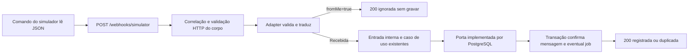

# Etapa 4.9 — Webhook Express e adapter do simulador

Preparada em 10/11/2026 na branch `feat/simulator-webhook`, sobre a entrega 4.8 revisada e enviada ao remoto. A entrega conecta a recepção PostgreSQL a um endpoint HTTP local e fornece um comando para enviar uma mensagem sintética. O worker continua pendente, portanto os jobs ficam armazenados sem execução e nenhuma saudação ou menu é enviado.

A revisão funcional e os testes manuais foram concluídos em 11/11/2026. O autor executou as requisições no Postman e compartilhou as respostas; o Codex orientou os testes e conferiu a persistência com consultas de leitura. As verificações automatizadas foram reexecutadas antes da organização dos commits.

**Resultado:** tipos e compilação passaram. `npm run check` aprovou 43 registros sem banco; `npm run test:integration` aprovou 56 registros em bancos descartáveis, incluindo o caminho HTTP completo. Não foram criadas ou executadas migrações no banco do projeto, modificadas credenciais ou implementadas funcionalidades de IA/painel.

## 1. Ordem de revisão por dependência

| Ordem | Arquivo | Responsabilidade |
|---|---|---|
| 1 | [package.json da API](../apps/api/package.json), [package.json raiz](../package.json) e [package-lock.json](../package-lock.json) | Dependências exatas de Express, tipos, comandos e inclusão de testes |
| 2 | [config/http.ts](../apps/api/src/config/http.ts), [seu teste](../apps/api/src/config/http.test.ts) e [.env.example](../.env.example) | Validar `API_PORT`, padrão 3000, sem imprimir valores inválidos. O `.env` real permanece igual |
| 3 | [adapters/simulator-message.ts](../apps/api/src/modules/messaging/adapters/simulator-message.ts) e [seu teste](../apps/api/src/modules/messaging/adapters/simulator-message.test.ts) | Conhecer o JSON do simulador, validar campos externos, filtrar ecos e traduzir para a mensagem interna |
| 4 | [http/http-errors.ts](../apps/api/src/http/http-errors.ts) | Formatar erros e eventos seguros e traduzir erros do parser JSON |
| 5 | [simulator-webhook-router.ts](../apps/api/src/modules/messaging/http/simulator-webhook-router.ts) | Definir `POST /`, exigir JSON, limitar o corpo, chamar adapter e entrada e escolher a resposta HTTP |
| 6 | [http/app.ts](../apps/api/src/http/app.ts) | Montar a aplicação, gerar correlação antes das rotas, montar o router no caminho público e registrar 404 e erro ao final |
| 7 | [http/listen-http.ts](../apps/api/src/http/listen-http.ts) | Abrir o servidor em `127.0.0.1` e aguardar a escuta; testes usam porta 0 para o sistema escolher uma livre |
| 8 | [index.ts](../apps/api/src/index.ts) | Compor configuração, pool, porta PostgreSQL e app; conferir conexão antes de escutar e encerrar HTTP antes do pool |
| 9 | [exemplo JSON](../apps/api/examples/simulator/text-message.json) e [scripts/simulate-message.ts](../apps/api/src/scripts/simulate-message.ts) | Definir um cenário sintético e enviá-lo ao endpoint usando `fetch` nativo |
| 10 | [http/app.test.ts](../apps/api/src/http/app.test.ts) | Exercitar HTTP real com um substituto da persistência, sem banco, incluindo códigos, erros e espera pela confirmação |
| 11 | [integração PostgreSQL](../apps/api/src/modules/messaging/infrastructure/postgres-incoming-message-inbox.integration.test.ts) | Revisar o cenário final novo: HTTP, adapter, caso de uso e transação real com reenvio e eco |

Os arquivos de caso de uso, contrato normalizado, porta de persistência e implementação SQL da etapa 4.8 não precisaram mudar. O cenário HTTP foi acrescentado à suíte descartável existente para reutilizar sua preparação e limpeza.

## 2. Fluxo executado



O adapter conhece `id`, `from`, `type`, `body` e `timestamp`; o caso de uso continua conhecendo `externalId`, `phone`, `kind`, `text` e `receivedAt`. Essa tradução é a D6 em código. Um provedor real terá outro adapter e sua própria documentação de payload, sem impor esse formato ao núcleo.

O router pertence à camada de entrada do módulo. Ele conhece HTTP e chama a recepção existente, mas não executa SQL nem decide a política de processamento de mídia. A aplicação Express recebe a porta por parâmetro; o teste fornece um substituto e o `index.ts` fornece `PostgresIncomingMessageInbox`. Essa composição mantém a D2/D22.

## 3. Conceitos de Express presentes no código

`Router()` agrupa as rotas de mensageria. Seu `POST /` é montado pela aplicação em `/webhooks/simulator`. O método e o caminho juntos identificam o endpoint.

Middlewares são executados na ordem do registro. A correlação é gerada primeiro. Na rota, o primeiro middleware confere `Content-Type`; `express.json` transforma o corpo em objeto JavaScript com limite de 64 KiB; só depois o handler valida o conteúdo. O tipo estático de `request.body` nesse handler é `unknown`: parsear JSON não torna seus campos confiáveis.

O handler é `async` e aguarda `receiveMessageInput`. Express 5 encaminha rejeições ao middleware de erro; não foi instalada biblioteca extra para isso. O middleware de erro recebe quatro argumentos e é registrado depois das rotas e do 404. `response.status(...).json(...)` define o status e devolve JSON ao cliente.

`createHttpApp` não abre porta nem banco. `listenHttp` abre a porta, e `index.ts` compõe tudo. Por isso os testes podem exercitar HTTP com dados controlados sem depender do PostgreSQL; o teste de integração pode trocar apenas a implementação da porta.

## 4. Contrato do simulador

```json
{
  "id": "simulador-texto-001",
  "from": "+15550000001",
  "fromMe": false,
  "type": "text",
  "body": "Olá! Gostaria de informações sobre os serviços.",
  "timestamp": "2026-11-10T12:00:00Z"
}
```

- `fromMe` é booleano obrigatório. Com `true`, o evento é ignorado antes de validar campos de mensagem recebida, sem chamar a persistência.
- `id` precisa ser texto não vazio e é preservado como identificador opaco.
- `from` precisa chegar no formato canônico já adotado. O adapter não adivinha DDI ou remove máscaras.
- `timestamp` exige ISO 8601 válido com fuso explícito (`Z` ou offset); o adapter o converte em `Date`.
- `type` aceita `text`, `audio` ou `other`. Para conteúdos diferentes de texto/áudio, o simulador usa explicitamente `other`; valores como `image` ainda não integram esse contrato.
- `body` só é obrigatório em `text`, com conteúdo não vazio. O texto é preservado.
- Campos extras são tolerados. A persistência recebe o corpo JSON original inteiro, enquanto a mensagem normalizada contém apenas os campos internos. O nome interno do provedor é sempre `simulador`.

O formato é definido pelo projeto para demonstração. Não comprova compatibilidade com Evolution, Cloud API ou outro provedor real.

## 5. Respostas e erros

| Situação | HTTP | Corpo principal |
|---|---|---|
| Persistência confirmada | 200 | `status: registrada`, `messageId` |
| Reenvio já registrado | 200 | `status: duplicada`, ID original |
| Mensagem própria | 200 | `status: ignorada`, `reason: mensagem_propria` |
| Campos inválidos | 400 | `code: invalid_payload`, nomes em `details.fields` |
| JSON malformado | 400 | `code: invalid_json` |
| Corpo acima do limite | 413 | `code: payload_too_large` |
| Content-Type ou codificação incompatível | 415 | `code: unsupported_media_type` |
| Rota inexistente | 404 | `code: route_not_found` |
| Falha inesperada, inclusive de persistência | 500 | `code: internal_error`, mensagem genérica |

Todo erro inclui `code`, `message` e `correlationId`; a correlação também está no cabeçalho `X-Correlation-ID`. O servidor sempre gera um UUID próprio, sem refletir um ID arbitrário recebido do cliente. Os eventos de erro possuem somente nível, código e correlação. Não incluem corpo, telefone, URL com parâmetros, stack, credenciais ou mensagem interna de exceção. A integração de observabilidade completa permanece para outra entrega.

O sucesso não é enviado antes de confirmar a persistência. O worker continua fora da requisição: o endpoint não chama IA, não envia menu e não consome os jobs criados.

## 6. Instalações e configuração

Comandos usados na raiz, com versões estáveis consultadas no npm e compatíveis com o Node instalado:

```powershell
npm install --workspace=@copilot-leads/api --save-exact express@5.3.0
npm install --workspace=@copilot-leads/api --save-dev --save-exact @types/express@5.0.6
```

Express é dependência de execução; `@types/express` fornece apenas tipos de desenvolvimento. As dependências transitivas ficaram no lockfile da raiz. `npm ci` reproduz esse conjunto; não é necessário reinstalar esses dois pacotes manualmente se eles já foram instalados nesta preparação.

`API_PORT` é opcional e tem padrão 3000. Foi acrescentada ao `.env.example`, sem modificar o `.env` existente. O servidor e o comando do simulador usam a mesma configuração. A escuta é local em `127.0.0.1`, adequada à demonstração inicial sem túnel ou provedor externo.

O ponto de entrada valida HTTP e banco, cria o pool e executa `SELECT 1` antes de escutar. Não aplica migrações nem verifica automaticamente toda a estrutura. Ao receber `SIGINT`/`SIGTERM`, encerra a aceitação e as requisições HTTP antes de encerrar o pool. Falha de configuração aponta nomes dos campos; outras falhas de inicialização usam mensagem genérica.

## 7. Verificação e execução manual

Comandos de verificação na raiz:

```powershell
npm run check
npm run test:integration
```

O primeiro passou em 43 registros: os 20 anteriores, três de configuração HTTP, seis do adapter e treze cenários HTTP com um agrupador. Um desses cenários executa o cliente compilado como processo filho e confirma que ele encontra o exemplo e envia a requisição à API. Usa portas aleatórias e não depende de banco. O segundo passou em 56 registros: os 55 anteriores e um novo cenário HTTP com PostgreSQL real no banco descartável da suíte. Esse cenário verifica mensagem/job únicos no reenvio, payload original preservado e eco sem gravação. Na preparação em 10/11/2026, a suíte antiga de contatos emitiu um aviso de conexão ociosa encerrada, sem falha de cenário ou limpeza. A revalidação em 11/11/2026 passou sem falhas e sem esse aviso.

Para testar manualmente, o PostgreSQL local precisa estar em execução e as quatro migrações já revisadas precisam estar aplicadas no banco definido no seu `.env`. Se estiverem pendentes, a aplicação delas continua sendo o comando separado `npm run db:migrate`, a ser executado pelo autor. Nenhuma migração foi executada no banco do projeto nesta preparação.

**Terminal 1, na raiz:**

```powershell
npm run start:api
```

O comando compila a API e inicia o Node com o `.env` da raiz. Aguarde a mensagem `API disponível em http://127.0.0.1:3000` (ou a porta configurada).

**Terminal 2, na mesma raiz:**

```powershell
npm run simulate:message
```

O comando compila o cliente e envia o arquivo versionado de exemplo, com timeout de 10 segundos. O primeiro envio de um par ainda não registrado retorna `registrada`; repetir o comando retorna `duplicada` com o mesmo ID. Para demonstrar uma nova mensagem do mesmo contato, altere apenas o `id` no exemplo. O ID fixo é intencional para demonstrar idempotência. Esses comandos manuais gravam dados sintéticos no banco configurado; os testes automatizados usaram somente bancos descartáveis.

Encerre a API com `Ctrl+C`. Ainda não haverá resposta automática ou processamento do job.

## 8. Resultados manuais no Postman

As requisições abaixo foram executadas pelo autor em 11/11/2026, com dados sintéticos. Os resultados foram observados nas respostas compartilhadas, sem presumir aprovação apenas pela implementação ou pelos testes automatizados.

| Cenário | HTTP observado | Resultado |
|---|---|---|
| Mensagem válida | 200 | `registrada`, ID correspondente ao banco e job pendente |
| Mensagem duplicada | 200 | `duplicada`, mesmo ID, sem novos registros ou alteração da última atividade |
| Mensagem própria | 200 | `ignorada`, sem contato, conversa, mensagem ou job |
| Payload inválido | 400 | `invalid_payload` para telefone inválido, texto vazio e ausência de `timestamp`, sem gravações |
| JSON malformado | 400 | `invalid_json`, sem gravações |
| Content-Type incorreto | 415 | `unsupported_media_type`, sem gravações |
| Rota inexistente | 404 | `route_not_found` em JSON |
| Áudio | 200 | Mensagem persistida como `audio`, sem job |
| Outra mídia | 200 | Mensagem persistida como `outro`, sem job |
| Corpo acima de 64 KiB | 413 | `payload_too_large`, sem gravações |

Todas as respostas tiveram `X-Correlation-ID`. Nos erros, o corpo continha `code`, `message` e `correlationId`, com o mesmo identificador do header. As consultas `SELECT` confirmaram os relacionamentos entre `contacts`, `conversations`, `messages` e `jobs`.

Depois do erro 413, o autor reenviou a primeira mensagem válida e recebeu `200`, `duplicada` e o mesmo ID. As contagens e a última atividade permaneceram iguais, confirmando a continuidade da API sem novos registros. Os dez cenários e a verificação adicional passaram; nenhuma correção de código foi necessária. Esses testes manuais gravaram dados sintéticos no banco do projeto, enquanto os automatizados usaram bancos descartáveis. Nenhuma migração foi executada no banco do projeto.

## 9. Auditoria e próxima entrega

O relatório completo de `npm audit --json` apontou três avisos moderados na cadeia de desenvolvimento `node-pg-migrate@9.0.0 → glob@13.0.6 → minimatch@10.2.6`, todos já presentes no lockfile anterior com as mesmas versões. `npm audit --omit=dev --json` retornou zero vulnerabilidades. Não foi aplicado `audit fix`; a proposta automática envolvia mudar a versão principal do migrador. Uma revisão de atualização dessa cadeia fica separada desta funcionalidade.

A próxima parte funcional será o worker, com reivindicação transacional, política de tentativas e processamento conforme o estado da conversa. A entrega atual foi revisada e organizada em commits locais na branch `feat/simulator-webhook`, sem push ou merge. Nenhuma mensagem foi enviada ao WhatsApp real.

Referências oficiais: [Express 5](https://expressjs.com/en/5x/api/), [tratamento de erros](https://expressjs.com/en/guide/error-handling/), [datas ISO no Zod](https://zod.dev/api#iso-datetimes) e os avisos reportados pelo npm para [glob](https://github.com/advisories/GHSA-3g3m-2fjr-6pw4) e [minimatch](https://github.com/advisories/GHSA-g3hv-75wg-m249).
