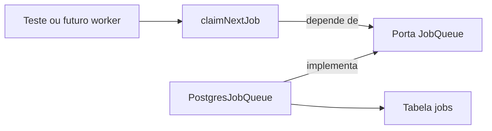

# Etapa 4.10 — Reivindicação segura de jobs

Preparada em 11/11/2026 na branch `feat/job-claim`, sobre a etapa 4.9 revisada e enviada ao GitHub. Esta entrega implementa a reserva de um job por chamada, com filtros de elegibilidade e proteção contra reservas concorrentes.

**Resultado:** `npm run check` passou em tipos, compilação e 46 registros sem banco. `npm run test:integration` passou em 66 registros, incluindo nove cenários novos e seu agrupador. Os bancos descartáveis foram removidos. Consultas de leitura compararam contagens e hashes dos registros de `contacts`, `conversations`, `messages`, `jobs` e `pgmigrations` antes e depois dos testes: os dados e o histórico do banco do projeto permaneceram iguais.

Não foram instaladas dependências, criadas migrações ou alteradas credenciais. Depois da revisão do autor, esta entrega foi enviada ao remoto nos commits `681b800`, `412e343` e `dce98c2`, sem merge ou rebase. A API continua sem consumo automático da fila; os jobs existentes no banco do projeto não foram reivindicados nesta entrega.

## 1. Ordem de revisão por dependência

| Ordem | Arquivo | Responsabilidade e pontos de revisão |
|---|---|---|
| 1 | [application/job-queue.ts](../apps/api/src/modules/jobs/application/job-queue.ts) | Definir o tipo de tarefa suportado, a reserva retornada e a porta `JobQueue`. Diferenciar ausência de trabalho de falha |
| 2 | [application/claim-next-job.ts](../apps/api/src/modules/jobs/application/claim-next-job.ts) | Escolher `processar_mensagem` e solicitar uma reserva pela porta, sem importar banco ou HTTP |
| 3 | [application/claim-next-job.test.ts](../apps/api/src/modules/jobs/application/claim-next-job.test.ts) | Verificar seleção do tipo suportado, resultado da reserva, fila vazia e propagação de falha usando um substituto da porta |
| 4 | [infrastructure/postgres-job-queue.ts](../apps/api/src/modules/jobs/infrastructure/postgres-job-queue.ts) | Implementar a porta com SQL parametrizado: selecionar, bloquear, atualizar e devolver o job na mesma instrução |
| 5 | [infrastructure/postgres-job-queue.integration.test.ts](../apps/api/src/modules/jobs/infrastructure/postgres-job-queue.integration.test.ts) | Exercitar o caso de uso com PostgreSQL real em banco descartável, incluindo concorrência, bloqueio e rollback |
| 6 | [package.json da API](../apps/api/package.json) | Incluir os dois arquivos de teste novos nos comandos existentes; scripts da raiz e dependências permanecem iguais |
| 7 | [modelagem](04-modelagem-de-dados.md), [fluxo](03-fluxo-e-ciclo-de-vida.md), [histórico](07-fluxo-de-desenvolvimento.md), [README raiz](../README.md) e [README da API](../apps/api/README.md) | Conferir o estado atual e distinguir reserva implementada de worker ainda pendente |

Os caminhos de código da tabela pertencem ao novo módulo `apps/api/src/modules/jobs`. Ele representa o controle da fila e não depende dos arquivos internos de mensageria. O identificador técnico `processar_mensagem` é o mesmo que a recepção já grava, sem incorporar dados da clínica.

## 2. Responsabilidades no monólito modular



O chamador fornece uma implementação de `JobQueue`. O caso de uso escolhe o tipo de trabalho; a infraestrutura conhece SQL, nomes das colunas e o mecanismo de bloqueio. O resultado usa `messageId`, `maxAttempts` e `lockedAt`, em vez dos nomes das colunas. Os contratos são internos ao backend e não foram colocados em `packages/shared`.

A aplicação não importa `pg`, Express ou o payload do simulador. A infraestrutura depende da porta da aplicação. Esse é o mesmo sentido de dependência usado na recepção de mensagens, aplicado a outra responsabilidade do monólito, conforme D1/D2/D4/D22.

O caso de uso é pequeno porque a política desta entrega é pequena: solicitar a tarefa suportada. Ele não simula processamento, não muda a conversa e não marca jobs como concluídos.

## 3. Elegibilidade e resultado da reserva

Um job só pode ser reservado quando reúne todas estas condições:

- `type` é o solicitado pelo caso de uso, atualmente `processar_mensagem`.
- `status` é `pendente`.
- `run_at` é menor ou igual ao horário atual do PostgreSQL.
- `attempts` é menor que `max_attempts`.
- Sua linha pode ser bloqueada imediatamente.

Entre os candidatos disponíveis, a seleção usa `run_at`, depois `created_at` e finalmente `id` como desempate. A consulta reserva no máximo uma linha.

Na mesma operação, `status` passa para `processando`, `attempts` aumenta em um e `locked_at` recebe o horário do banco. O job mantém seu ID, vínculo à mensagem, limite de tentativas, agendamento, data de criação e erro anterior. A reserva retorna o contador já incrementado e a data persistida. O erro anterior fica disponível para diagnóstico; a política de limpeza desse campo pertence ao ciclo de execução futuro.

Quando não existe candidato disponível, o retorno é `undefined`. Uma falha do PostgreSQL continua sendo uma rejeição da Promise: o chamador poderá distinguir falta de trabalho de indisponibilidade da fila.

O limite vem de cada registro, não de uma constante igual a três. Um job que já esgotou suas tentativas é ignorado e permanece como estava; a definição de falha definitiva pertence à próxima parte.

## 4. Como a transação e o bloqueio funcionam

A consulta possui uma CTE chamada `candidate`. Ela seleciona uma linha com `FOR UPDATE SKIP LOCKED`; o `UPDATE` usa esse candidato e devolve os campos com `RETURNING`.

As duas operações compõem uma única instrução SQL. O PostgreSQL executa essa instrução em uma transação implícita: se houver sucesso, confirma a alteração; se houver falha, desfaz os efeitos. Por isso esta implementação pode usar uma única chamada a `pool.query`, sem distribuir uma transação entre chamadas diferentes do pool. Se a operação passar a exigir várias instruções, será necessário reavaliar a reserva de um cliente e o bloco explícito de transação.

`FOR UPDATE` protege a linha enquanto a instrução a reserva. `SKIP LOCKED` permite buscar outro candidato quando a linha está bloqueada por outra transação. Depois da confirmação, o bloqueio de linha termina, mas o estado `processando` persiste e exclui o job das próximas reservas. `locked_at` registra a data; não mantém um bloqueio SQL aberto.

A ordenação vale entre candidatos disponíveis. Um job bloqueado pode ser ultrapassado por outro; esta entrega não garante ordem estrita de processamento das mensagens de uma conversa. Também não demonstra execução de efeitos exatamente uma vez. Ordenação por conversa, recuperação e idempotência dos efeitos serão tratadas antes de ativar o processamento.

Referências oficiais: [transações implícitas no PostgreSQL 18](https://www.postgresql.org/docs/18/tutorial-transactions.html) e [bloqueios com SKIP LOCKED](https://www.postgresql.org/docs/18/sql-select.html#SQL-FOR-UPDATE-SHARE).

## 5. O que os testes demonstram

Os três testes sem banco exercitam a política do caso de uso pela porta: tipo suportado e preservação da reserva, ausência de trabalho e propagação de falha.

Os nove cenários de integração verificam:

1. Fila vazia sem alterações.
2. Atualização conjunta de estado, tentativa e data, preservando os demais campos e o vínculo.
3. Exclusão de jobs futuros, esgotados, em outros estados ou de tipo não suportado.
4. Seleção por `run_at`, `created_at` e `id`.
5. Uso da última tentativa disponível, respeitando inclusive um máximo diferente do padrão.
6. Duas chamadas concorrentes para um único job, com apenas uma reserva e um incremento.
7. Duas chamadas concorrentes reservando jobs distintos.
8. Uma linha mantida sob `FOR UPDATE` por outro cliente: a reserva pula essa linha, retorna ausência quando só ela resta e a encontra depois do desbloqueio.
9. Uma falha provocada por trigger após o `UPDATE`: a reserva é desfeita e uma nova chamada funciona após remover o trigger.

A suíte exige um PostgreSQL local e permissão para criar bancos. Gera um banco `copilot_job_claim_test_<UUID>`, aplica nele as quatro migrações existentes e cria apenas dados sintéticos. O `TRUNCATE` entre cenários e o trigger de falha existem somente nesse banco. No encerramento, fecha o pool e remove apenas o banco criado pela própria execução, aguardando o término das conexões do migrador.

## 6. Comandos para revisão

Na raiz do projeto:

```powershell
npm run check
npm run test:integration
```

O primeiro dispensa banco. O segundo precisa do PostgreSQL disponível; usa os bancos descartáveis de cada suíte e não aplica migrações no banco do projeto. Não é necessário executar `npm run db:migrate` para esta entrega.

Para executar somente os testes novos, compile a API e rode:

```powershell
npm run build --workspace=@copilot-leads/api
node --test apps/api/dist/modules/jobs/application/claim-next-job.test.js
node --env-file=.env --test apps/api/dist/modules/jobs/infrastructure/postgres-job-queue.integration.test.js
```

Foram aprovados 46 registros sem banco, os 43 anteriores mais três novos. A integração aprovou 66 registros, os 56 anteriores mais nove cenários novos e seu agrupador. Não houve falhas ou testes ignorados. A remoção dos bancos descartáveis foi conferida por leitura do catálogo.

Esta entrega não cria rotas HTTP; seu comportamento novo é verificado pelo caso de uso e pelos testes de integração. Iniciar a API ou reenviar um webhook no Postman mantém o comportamento da etapa 4.9: texto cria job pendente, sem consumidor automático.

## 7. Próxima parte

A etapa 4.11 acrescenta conclusão da tentativa atual, reagendamento de falhas transitórias, respeito ao limite persistido e proteção contra uma execução antiga finalizar uma reserva posterior. O [documento 19](19-etapa-4-finalizacao-de-jobs.md) apresenta o fluxo de revisão. A recuperação de trabalhos interrompidos permanece para a próxima parte; a política de novas tentativas da fila continua separada da política específica da IA.

O loop do worker, o encerramento coordenado com a API e o processamento das conversas ficam para os blocos seguintes. A ativação do consumo precisa de um processador real; um handler vazio não deve consumir e concluir os jobs existentes. O envio único da abertura e a ordenação das mensagens por conversa também precisam ser definidos antes desse processamento.
