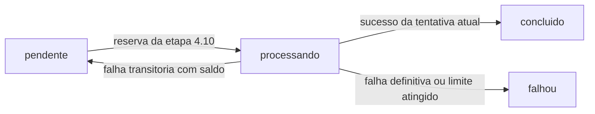

# Etapa 4.11 — Finalização e novas tentativas de jobs

Preparada em 11/11/2026 na branch `feat/job-lifecycle`, sobre a etapa 4.10 revisada e enviada ao GitHub. Esta entrega acrescenta conclusão, reagendamento de falhas transitórias e falha definitiva, com proteção pela identidade da tentativa atual.

**Resultado:** `npm run check` passou em tipos, compilação e 56 registros sem banco. `npm run test:integration` passou em 82 registros, incluindo quinze cenários novos e seu agrupador. Nenhuma falha ou teste ignorado. Os bancos descartáveis foram removidos; contagens e hashes dos registros de `contacts`, `conversations`, `messages`, `jobs` e `pgmigrations` permaneceram iguais no banco do projeto antes e depois dos testes.

Não foram instalados pacotes, criadas migrações ou alteradas credenciais. A API continua sem consumo automático da fila; os jobs existentes no banco do projeto não foram reservados ou finalizados. As alterações ficam locais para revisão, sem commit, push ou merge desta etapa.

## 1. Ordem de revisão por dependência

Os caminhos de código abaixo pertencem a `apps/api/src/modules/jobs`.

| Ordem | Arquivo | Responsabilidade e pontos de revisão |
|---|---|---|
| 1 | [application/job-lifecycle.ts](../apps/api/src/modules/jobs/application/job-lifecycle.ts) | Definir a identidade da tentativa, classificação de falha, decisão de repetição e resultados. A porta `JobLifecycle` é separada de `JobQueue` |
| 2 | [application/retry-policy.ts](../apps/api/src/modules/jobs/application/retry-policy.ts) e [seu teste](../apps/api/src/modules/jobs/application/retry-policy.test.ts) | Centralizar o intervalo crescente e o tratamento de falha definitiva, sem relógio, espera, SQL ou HTTP |
| 3 | [application/complete-job.ts](../apps/api/src/modules/jobs/application/complete-job.ts) | Solicitar conclusão pela porta e preservar seu resultado, inclusive reserva desatualizada |
| 4 | [application/fail-job.ts](../apps/api/src/modules/jobs/application/fail-job.ts) | Aplicar a política à classificação recebida e solicitar a atualização pela porta |
| 5 | [application/job-lifecycle.test.ts](../apps/api/src/modules/jobs/application/job-lifecycle.test.ts) | Verificar decisões e resultados com substitutos da persistência; distinguir perda da reserva de falha da infraestrutura |
| 6 | [infrastructure/postgres-job-queue.ts](../apps/api/src/modules/jobs/infrastructure/postgres-job-queue.ts) | Revisar os métodos novos `complete` e `fail`: updates condicionais, limite persistido, relógio do banco e códigos fixos. A consulta de reserva da etapa 4.10 foi preservada |
| 7 | [infrastructure/postgres-job-lifecycle.integration.test.ts](../apps/api/src/modules/jobs/infrastructure/postgres-job-lifecycle.integration.test.ts) | Verificar o ciclo real, agendamento, limite, tentativas antigas, concorrência e rollback em banco descartável |
| 8 | [package.json da API](../apps/api/package.json), [fluxo](03-fluxo-e-ciclo-de-vida.md), [modelagem](04-modelagem-de-dados.md), [histórico](07-fluxo-de-desenvolvimento.md), [guia anterior](18-etapa-4-reivindicacao-de-jobs.md) e READMEs | Conferir os comandos e o estado atual, distinguindo operações disponíveis de consumo automático ainda pendente |

## 2. Responsabilidades no monólito modular

O caso de uso depende de `JobLifecycle`; `PostgresJobQueue` implementa essa porta e continua implementando `JobQueue`. Quem apenas reserva um job mantém o contrato da etapa 4.10 e não precisa conhecer finalização ou reagendamento. Os testes anteriores de reserva continuam usando seus próprios substitutos sem métodos extras.

`retry-policy.ts` decide se a classificação permite repetição e calcula a espera. `fail-job.ts` entrega essa decisão à porta. A infraestrutura confere a tentativa e o limite da linha atual antes de efetivar a transição. Isso evita confiar no limite de uma cópia antiga da reserva ou separar uma leitura do contador de sua atualização.

As camadas de aplicação não importam `pg`, Express ou payloads do simulador. O código SQL fica na infraestrutura e os contratos permanecem internos ao backend, sem alterações em `packages/shared`.

## 3. Transições implementadas



| Operação | Alteração persistida |
|---|---|
| Conclusão válida | `concluido`, `locked_at = NULL`, `last_error = NULL` |
| Falha transitória com `attempts < max_attempts` | `pendente`, novo `run_at`, `locked_at = NULL`, código `processing_transient_failure` |
| Falha transitória com limite atingido | `falhou`, `locked_at = NULL`, código `processing_transient_failure`; mantém `run_at` |
| Falha definitiva | `falhou`, `locked_at = NULL`, código `processing_permanent_failure`; mantém `run_at` |
| Reserva que não corresponde à linha atual | Retorna `reserva_desatualizada`, sem alterar o job |

Nenhuma dessas operações cria outro registro, muda o vínculo à mensagem ou incrementa `attempts`. O contador aumenta somente na reserva. `max_attempts` e `created_at` são preservados; a conclusão também mantém `run_at`.

`concluido` significa que a tentativa de processamento do job foi concluída. Não encerra a conversa, não muda a situação de um lead e não confirma um agendamento clínico.

## 4. Política de novas tentativas

A classificação aceita `transitoria` ou `definitiva`. O futuro processador será responsável por classificar a falha; estes casos de uso não analisam mensagens de exceção. A porta não recebe texto de erro, telefone ou payload. A infraestrutura persiste somente os dois códigos controlados da tabela anterior.

Uma falha transitória propõe espera de `5 × 2^(attempts - 1)` segundos, com teto de 60 segundos. Portanto os intervalos são 5, 10, 20, 40 e 60 segundos, mantendo 60 nas tentativas seguintes quando o registro permitir. Esses parâmetros técnicos ficam centralizados na política, sem biblioteca nova ou configuração da clínica embutida.

O contador precisa ser um inteiro positivo seguro. Contadores inválidos são rejeitados com erro genérico, sem expor o valor. Uma classificação diferente de `transitoria` não autoriza repetição; o contrato TypeScript prevê apenas as duas classificações conhecidas.

O intervalo só é aplicado se o banco ainda permitir outra tentativa. No padrão de três tentativas totais:

1. A reserva incrementa para 1. Uma falha transitória reagenda para daqui a 5 segundos.
2. A nova reserva incrementa para 2. Uma falha transitória reagenda para daqui a 10 segundos.
3. A nova reserva incrementa para 3. Outra falha transitória marca `falhou`, sem agendar uma quarta execução.

O banco calcula `run_at` usando `CURRENT_TIMESTAMP`, somando o intervalo enviado pela política. Não há `setTimeout`, espera dentro da requisição ou incremento adicional ao reagendar. A política da fila permanece separada da repetição específica de chamadas de IA.

## 5. Proteção contra finalização antiga ou concorrente

Cada update exige simultaneamente:

- O mesmo `id` do job.
- `status = 'processando'`.
- O mesmo `attempts` da reserva, com contador maior que zero.

Se uma reserva posterior já elevou o contador de 1 para 2, uma conclusão da tentativa 1 não encontra uma linha válida. O mesmo vale para falhas antigas, jobs já finalizados, pendentes ou inexistentes. Todos retornam `reserva_desatualizada`; esse resultado não informa que a alteração foi aplicada e não substitui uma exceção de infraestrutura.

Duas finalizações concorrentes disputam a mesma linha. A primeira alteração válida muda seu estado; a outra deixa de satisfazer a condição e retorna reserva desatualizada. O contador nunca é zerado neste fluxo e precisa continuar monotônico na futura recuperação. `locked_at` permanece metadado de data, não a identidade usada para autorizar a atualização.

Cada método usa um único `UPDATE ... WHERE ... RETURNING`, executado em sua transação implícita. Falhas rejeitam a Promise e desfazem a instrução. Não há leitura separada seguida de escrita desprotegida.

Essa proteção vale para o estado da fila. Ela não impede, por si só, efeitos externos duplicados, como enviar um menu duas vezes, nem recupera automaticamente trabalhos interrompidos. Essas regras permanecem para os blocos seguintes.

Referências oficiais: [transações no PostgreSQL 18](https://www.postgresql.org/docs/18/tutorial-transactions.html) e [updates concorrentes em Read Committed](https://www.postgresql.org/docs/18/transaction-iso.html#XACT-READ-COMMITTED).

## 6. O que foi verificado

Os dez testes novos sem banco cobrem a política de espera, limite de intervalo, contador inválido, classificação definitiva, decisões encaminhadas, resultados de reserva desatualizada e propagação de falhas. Somados aos 46 anteriores, são 56 registros aprovados.

Os quinze cenários novos de integração verificam:

1. Conclusão com limpeza de trava/erro e preservação dos demais campos.
2. Repetição da conclusão sem reaplicar a alteração.
3. Reagendamento de cinco segundos com horário do banco e indisponibilidade antes de `run_at`.
4. Reagendamento de dez segundos na segunda tentativa.
5. Limite esgotado, inclusive quando o máximo é diferente de três.
6. Falha definitiva antes de esgotar o limite.
7. Uso do limite atual persistido, mesmo quando a reserva guardava outro valor.
8. ID inexistente ou contador diferente sem alterações.
9. Estados pendente, concluído e falhou protegidos contra sobrescrita.
10. Tentativa antiga incapaz de concluir ou registrar falha numa reserva posterior.
11. Ciclo de três tentativas totais no mesmo job e na mesma mensagem.
12. Duas conclusões concorrentes com apenas uma aplicada.
13. Conclusão concorrente com reagendamento, preservando a decisão vencedora.
14. Falhas transitória e definitiva concorrentes com apenas uma aplicada.
15. Erro de trigger após o update desfazendo conclusão, reagendamento e falha definitiva; nova chamada funciona após remover o trigger.

A suíte exige PostgreSQL local e permissão para criar bancos. Cria `copilot_job_lifecycle_test_<UUID>`, aplica nele as quatro migrações existentes e usa dados sintéticos. A limpeza entre cenários, a antecipação de `run_at`, o ajuste de limite e o trigger de falha atuam somente nesse banco. Os testes não aguardam os intervalos reais: simulam a chegada do horário na fixture.

No encerramento, a suíte fecha suas conexões e remove apenas o banco criado pela própria execução. As sete suítes de integração passaram em 82 registros: os 66 anteriores, quinze cenários novos e seu agrupador. A ausência de bancos descartáveis restantes foi conferida por leitura do catálogo.

## 7. Comandos e fluxo para revisão

Na raiz do projeto:

```powershell
npm run check
npm run test:integration
```

O primeiro não exige banco. O segundo usa o PostgreSQL local, atualmente executado no Docker, e bancos descartáveis por suíte. Antes de utilizá-lo, mantenha o Docker Desktop e o serviço PostgreSQL disponíveis. A [documentação oficial do Compose](https://docs.docker.com/compose/intro/compose-application-model/) explica o serviço já configurado. Não é necessário executar `npm run db:migrate` para esta entrega.

Para rodar somente os testes novos, após compilar:

```powershell
npm run build --workspace=@copilot-leads/api
node --test apps/api/dist/modules/jobs/application/retry-policy.test.js apps/api/dist/modules/jobs/application/job-lifecycle.test.js
node --env-file=.env --test apps/api/dist/modules/jobs/infrastructure/postgres-job-lifecycle.integration.test.js
```

Esta entrega não adiciona endpoints ou ativa um worker. A validação do comportamento novo acontece pelos casos de uso e pelo PostgreSQL descartável. A API mantém o comportamento já revisado: texto recebido gera job pendente, ainda sem execução automática.

## 8. Próxima parte

Implementar recuperação de jobs interrompidos, com prazo de reserva e preservação do contador. Depois, conectar o loop do worker e seu encerramento coordenado ao processamento real. Antes de ativar o consumo, detalhar ordenação por conversa, envio único da abertura e idempotência dos efeitos. Nenhum handler vazio deve consumir e concluir os jobs existentes apenas para demonstrar o loop.
