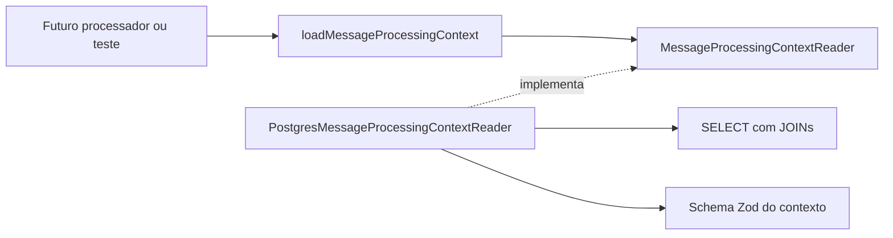

# Etapa 4.13 — Carregamento do contexto da mensagem

Preparada em 13/11/2026 na branch `feat/message-processing-context`, sobre a etapa 4.12 revisada e enviada ao GitHub. Esta entrega disponibiliza a leitura interna de uma mensagem com a conversa e o contato associados, como preparação para o processador real.

**Validação executada:** `npm run check` passou em tipos, compilação e 62 registros de testes sem banco. `npm run test:integration` passou em 111 registros, com zero falhas, cancelados ou ignorados. A etapa acrescentou três testes sem banco e nove cenários de integração, além do agrupador da suíte. O aviso de conexão ociosa observado na execução anterior não apareceu nesta execução; sua causa não foi diagnosticada ou corrigida nesta entrega.

Consultas de leitura antes e depois confirmaram as mesmas contagens e hashes de `contacts`, `conversations`, `messages`, `jobs` e `pgmigrations` no banco do projeto. Não restaram bancos descartáveis. Não foram instaladas dependências, criadas migrações ou alteradas credenciais. O autor autorizou organizar os commits e enviar esta branch ao GitHub para revisão em outra aba do ChatGPT, podendo solicitar ajustes durante o desenvolvimento. A revisão técnica desta entrega continua pendente; a integração na `main` será uma decisão posterior.

## 1. Problema e escopo

Um job reservado contém o `messageId`, mas o futuro processador também precisará do texto, da conversa, do estado atual e do contato. Carregar esse contexto é uma responsabilidade de leitura do módulo de mensageria; os contratos da fila não precisam carregar regras ou dados da clínica.

A operação usa o UUID da mensagem persistida. Segue `messages.conversation_id` e depois `conversations.contact_id`, inclusive quando a conversa está encerrada. Não substitui o vínculo original pela conversa aberta mais recente do contato.

O resultado é uma fotografia dos dados consultados. Ainda não existe execução automática, decisão por estado ou resposta ao cliente neste bloco.

## 2. Ordem de revisão por dependência

Os caminhos de código abaixo pertencem a `apps/api/src/modules/messaging`.

| Ordem | Arquivo | Responsabilidade e pontos de revisão |
|---|---|---|
| 1 | [contracts/message-processing-context.ts](../apps/api/src/modules/messaging/contracts/message-processing-context.ts) | Definir o schema Zod e derivar o tipo interno. Conferir campos, nulabilidade, estados, direção, remetente e data de persistência |
| 2 | [application/message-processing-context-reader.ts](../apps/api/src/modules/messaging/application/message-processing-context-reader.ts) | Definir a porta de leitura pelo ID original. Distinguir ausência de mensagem de falha e deixar explícito que a leitura não autoriza efeitos |
| 3 | [application/load-message-processing-context.ts](../apps/api/src/modules/messaging/application/load-message-processing-context.ts) | Solicitar a leitura pela interface e preservar resultado, ausência ou exceção; sem SQL ou regras de atendimento |
| 4 | [application/load-message-processing-context.test.ts](../apps/api/src/modules/messaging/application/load-message-processing-context.test.ts) | Conferir o ID recebido, preservação do resultado, ausência e propagação de falhas com substitutos da persistência |
| 5 | [infrastructure/postgres-message-processing-context-reader.ts](../apps/api/src/modules/messaging/infrastructure/postgres-message-processing-context-reader.ts) | Implementar um único SELECT parametrizado com JOINs pelos vínculos originais; mapear colunas e validar os dados antes de devolver o contexto |
| 6 | [infrastructure/postgres-message-processing-context-reader.integration.test.ts](../apps/api/src/modules/messaging/infrastructure/postgres-message-processing-context-reader.integration.test.ts) | Verificar dados reais, estados, histórico, nulabilidade, concorrência, erro seguro e preservação dos registros |
| 7 | [package.json da API](../apps/api/package.json), READMEs, [fluxo](03-fluxo-e-ciclo-de-vida.md), [modelagem](04-modelagem-de-dados.md), [contratos](05-contratos-de-dados.md), [histórico](07-fluxo-de-desenvolvimento.md) e [guia anterior](20-etapa-4-recuperacao-de-jobs.md) | Conferir os comandos e distinguir leitura implementada de processamento e consumo ainda pendentes |

## 3. Responsabilidades e dependências



A aplicação depende da porta, enquanto a infraestrutura depende do contrato da aplicação e do banco. O caso de uso é pequeno de propósito: nesta entrega só encaminha a leitura; não introduz regras de processamento para preencher o espaço de um worker ainda inexistente.

O contrato permanece dentro de mensageria, no backend. `packages/shared` continua reservado para contratos públicos usados por API e frontend. O módulo de jobs, as rotas e `src/index.ts` não foram modificados; a composição com o processador será feita em uma entrega posterior.

## 4. Formato do contexto e limites dos dados

| Parte | Campos |
|---|---|
| `message` | `id`, `provider`, `externalId`, `direction`, `senderType`, `kind`, `body`, `createdAt` |
| `conversation` | `id`, `status` |
| `contact` | `id`, `phone`, `displayName` |

`body` e `displayName` preservam `null`. O banco permite `body = NULL` inclusive quando `kind = 'texto'`; a leitura representa o registro existente, sem inventar conteúdo ou presumir que ele está pronto para qualificação. O schema de mensagem normalizada da entrada continua separado e não foi relaxado.

`message.createdAt` é a data de persistência de `messages.created_at`. A data de origem do provedor não tem coluna própria nessa tabela. O leitor não extrai datas do JSON bruto nem afirma que essa data resolve a ordenação de mensagens.

Direção e remetente são preservados, inclusive em mensagens de saída. Áudio, outros conteúdos e os seis estados da conversa também são representados. A decisão de processar, ignorar ou encaminhar será do futuro processador; não é um filtro escondido nesta consulta.

O SELECT enumera apenas as colunas necessárias. Não carrega `raw_payload`, histórico completo ou dados da fila. Espaços e quebras de linha do texto e do nome são preservados.

O UUID de entrada é um identificador interno, esperado a partir de uma mensagem persistida, como o `messageId` do job. Não foi criada uma entrada HTTP para essa operação. Um futuro endpoint precisará validar e autorizar sua própria entrada; o leitor não substitui essa fronteira.

## 5. Leitura consistente, ausência e falhas

A infraestrutura faz um único SELECT com INNER JOINs pelos IDs protegidos pelas chaves estrangeiras existentes. Mensagem, conversa e contato pertencem à mesma fotografia da instrução. Não é necessário buscar cada parte em consultas separadas, nem abrir uma transação explícita apenas para esse SELECT.

Uma atualização concorrente ainda não confirmada não aparece na leitura. Depois do commit, outra chamada pode trazer o nome e o estado atualizados. Esse comportamento é descrito na documentação oficial de [Read Committed no PostgreSQL 18](https://www.postgresql.org/docs/18/transaction-iso.html#XACT-READ-COMMITTED).

**A leitura não reserva o job, não adquire bloqueio de linha para decidir atendimento e não concede autorização para envio.** O estado pode mudar depois do SELECT, por exemplo quando um atendente assumir a conversa. A futura decisão com efeitos deverá tratar concorrência, ordenação e idempotência; reutilizar uma fotografia antiga como autorização seria incorreto.

Um UUID válido sem mensagem correspondente retorna `undefined`. Falhas da consulta rejeitam a Promise e são propagadas; não são convertidas em ausência. A validação Zod usa `safeParse` e, se os dados não corresponderem ao contrato, lança somente `O contexto persistido da mensagem é inválido.`, sem incluir telefone, texto, payload ou detalhes dos campos rejeitados.

A suíte verifica essa diferença com um provedor composto por tabulação: o CHECK SQL atual usa `btrim`, que remove espaços por padrão, enquanto a validação do contrato também rejeita tabulação. A fixture existe somente no banco descartável e comprova a rejeição segura sem remover restrições ou mudar migrações. Referência: [funções de texto do PostgreSQL](https://www.postgresql.org/docs/18/functions-string.html).

Nenhum desses resultados decide como concluir ou reagendar um job. Essa classificação pertence à integração futura com o processador.

## 6. Testes e isolamento

Os três testes sem banco verificam o ID entregue à porta, a preservação do resultado, a ausência de contexto e a propagação de indisponibilidade.

Os nove cenários de integração verificam:

1. Contexto completo com campos preservados, sem JSON bruto ou efeitos nas cinco tabelas auditadas, incluindo um job pendente.
2. Texto, áudio e outros conteúdos com corpo e nome nulos.
3. Os seis estados, incluindo atendimento humano e conversa encerrada.
4. Mensagem antiga continuando vinculada à conversa encerrada quando o contato já tem novo ciclo aberto.
5. Busca pelo UUID correto quando dois provedores usam o mesmo ID externo.
6. Mensagens de saída preservando direção e remetente.
7. Mensagem inexistente sem alterações nos registros existentes.
8. Leitura durante uma atualização ainda não confirmada, seguida por nova leitura após o commit, sem espera artificial.
9. Contexto incompatível com o schema rejeitado com erro seguro, sem virar ausência e sem impedir a leitura de outro contexto válido.

A suíte exige PostgreSQL local e permissão para criar bancos. Cria `copilot_context_test_<UUID>`, aplica somente nele as quatro migrações existentes e fecha suas conexões antes de removê-lo. Inserts, limpeza entre cenários e atualizações de fixtures atuam exclusivamente nesse banco, com dados sintéticos. O teste de concorrência usa uma transação real e não depende de timers.

As nove suítes de integração passaram com 111 registros: os 101 anteriores e os nove cenários novos, mais seu agrupador. As contagens e hashes dos dados e do histórico de migrações do banco do projeto permaneceram iguais, e nenhum banco descartável restou.

## 7. Comandos para sua revisão

Na raiz:

```powershell
npm run check
npm run test:integration
```

São esperados 62 registros sem banco e 111 de integração aprovados. Não é necessário iniciar a API ou executar `npm run db:migrate` nesta entrega.

O PostgreSQL local está no Docker. Mantenha o Docker Desktop aberto; se o serviço estiver parado, este comando o inicia usando o volume existente:

```powershell
docker compose up -d --wait --wait-timeout 120 postgres
```

Consulte o [guia local do PostgreSQL](09-etapa-4-postgres-local.md) e a [documentação oficial do Compose](https://docs.docker.com/compose/intro/compose-application-model/) para revisar serviço, container e volume.

Para executar apenas os testes novos:

```powershell
npm run build --workspace=@copilot-leads/api
node --test apps/api/dist/modules/messaging/application/load-message-processing-context.test.js
node --env-file=.env --test apps/api/dist/modules/messaging/infrastructure/postgres-message-processing-context-reader.integration.test.js
```

## 8. Próxima parte

Preparar as decisões do processamento por estado e a configuração do perfil fictício da clínica, detalhando ordenação por conversa e idempotência dos efeitos antes de ativar o consumo. O futuro processador poderá usar esta porta para obter contexto, mas ainda precisará validar a tentativa atual, tratar mudanças concorrentes e respeitar tempos máximos compatíveis com a reserva. O loop, a recuperação periódica e o encerramento coordenado permanecem para suas próprias entregas.
