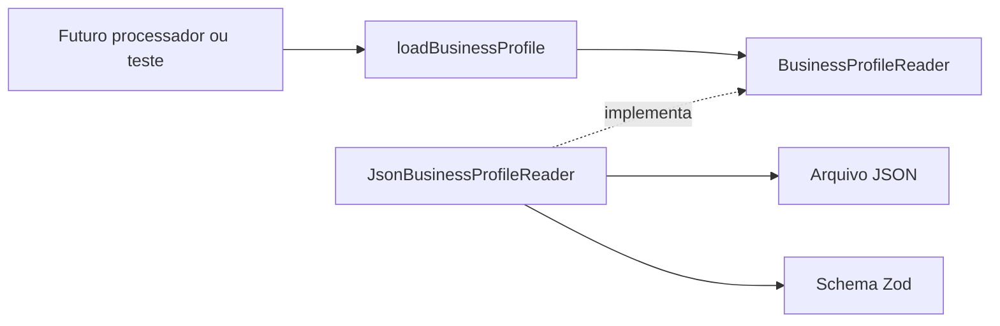

# Etapa 4.14 — Perfil configurável da clínica

Preparada em 13/11/2026 na branch `feat/business-profile`, sobre a etapa 4.13 enviada ao GitHub para revisão. Esta entrega disponibiliza o perfil fictício por um arquivo JSON versionado, validado com Zod e acessado por uma porta de leitura.

**Validação executada:** `npm run check` passou em tipos, compilação e **78 registros sem banco**, sem falhas, cancelamentos ou ignorados. São 16 testes novos: nove de contrato, dois de aplicação e cinco do leitor de arquivo. Os testes do leitor usam arquivos reais temporários e um processo Node iniciado fora da pasta do projeto.

A suíte PostgreSQL não foi repetida: nenhum caminho de banco ou seu comando de integração foi alterado. O último resultado, na etapa 4.13, foi de 111 registros aprovados. Nesta entrega não houve acesso ao PostgreSQL, uso do Docker, novas dependências, migrações ou alterações de credenciais. Não foram feitos commits, push ou merge da etapa 4.14.

## 1. Objetivo e recorte

Nome, serviços, preços, horários e textos variam conforme o negócio. O perfil fica em dados, enquanto a aplicação depende de uma interface que fornece uma configuração válida. A escolha inicial é um único JSON no backend; uma implementação futura da mesma porta poderá buscar o perfil no PostgreSQL.

O perfil é uma proposta inteiramente sintética para revisão: Clínica Movimento, avaliação por R$ 120,00 e sessão por R$ 100,00, fuso `America/Sao_Paulo`, segunda a sexta das 08h às 12h e das 13h às 18h. Esses valores não representam preços pesquisados ou uma clínica real. O catálogo contém somente descrições administrativas.

Esta entrega lê e valida os dados. A composição das mensagens, a comparação do horário atual com o expediente e as decisões por estado serão preparadas nos próximos blocos. Os campos extras de qualificação por IA continuam planejados para a integração de IA e não fazem parte deste primeiro contrato de execução.

## 2. Ordem de revisão por dependência

Os caminhos de código abaixo pertencem a `apps/api/src/modules/business-profile`.

| Ordem | Arquivo | Responsabilidade e pontos de revisão |
|---|---|---|
| 1 | [contracts/business-profile.ts](../apps/api/src/modules/business-profile/contracts/business-profile.ts) | Definir o schema Zod e derivar o tipo. Conferir nulabilidade de preço, fuso, horários, unicidade e campos desconhecidos |
| 2 | [config/business-profile.json](../apps/api/config/business-profile.json) | Revisar os dados fictícios: nome, serviços, valores, expediente, menu e textos-base |
| 3 | [application/business-profile-reader.ts](../apps/api/src/modules/business-profile/application/business-profile-reader.ts) | Definir a porta de leitura do único perfil da V1, com falhas explícitas e resultado validado |
| 4 | [application/load-business-profile.ts](../apps/api/src/modules/business-profile/application/load-business-profile.ts) e [seu teste](../apps/api/src/modules/business-profile/application/load-business-profile.test.ts) | Solicitar o perfil pela interface, preservar resultado e propagar falhas sem fabricar configuração |
| 5 | [contracts/business-profile.test.ts](../apps/api/src/modules/business-profile/contracts/business-profile.test.ts) | Verificar os dados versionados e as regras de validação, incluindo configurações alternativas |
| 6 | [infrastructure/json-business-profile-reader.ts](../apps/api/src/modules/business-profile/infrastructure/json-business-profile-reader.ts) | Ler UTF-8, interpretar JSON como unknown, validar o contrato e distinguir erros seguros por código |
| 7 | [infrastructure/json-business-profile-reader.test.ts](../apps/api/src/modules/business-profile/infrastructure/json-business-profile-reader.test.ts) | Verificar leitura real, independência do diretório atual, falhas e releitura sem estado compartilhado |
| 8 | [package.json da API](../apps/api/package.json) | Conferir a inclusão dos três arquivos de teste no comando sem banco. Dependências e testes PostgreSQL não mudaram |
| 9 | READMEs, [arquitetura](02-decisoes-de-arquitetura.md), [fluxo](03-fluxo-e-ciclo-de-vida.md), [modelagem](04-modelagem-de-dados.md), [contratos](05-contratos-de-dados.md), [histórico](07-fluxo-de-desenvolvimento.md) e [guia anterior](21-etapa-4-contexto-da-mensagem.md) | Conferir a escolha do arquivo, os limites e a revisão em paralelo ainda em andamento |

## 3. Responsabilidades no monólito modular



O novo módulo `business-profile` é responsável pela configuração do negócio. A aplicação conhece `BusinessProfileReader`; a infraestrutura conhece o sistema de arquivos e implementa essa porta. O caso de uso permanece pequeno: seu papel atual é disponibilizar uma dependência estável para a composição futura.

O schema e o tipo derivado pertencem ao backend. Não foram acrescentados contratos a `packages/shared` ou imports de sistema de arquivos na aplicação. Mensageria, jobs, rotas e `src/index.ts` permaneceram inalterados. A API ainda não carrega o perfil automaticamente.

## 4. Contrato e decisões dos dados

| Campo | Regra |
|---|---|
| `name` | Texto preenchido, preservado como informado |
| `timezone` | Identificador reconhecido pelo `Intl.DateTimeFormat` disponível no Node; o exemplo usa `America/Sao_Paulo` |
| `currency` | `BRL` neste primeiro contrato |
| `openingHours` | Lista de faixas com `dayOfWeek`, `start` e `end` |
| `services` | Catálogo não vazio; ID único, nome, descrição e `priceInCents` |
| `menuOptions` | Três opções, com número textual e ação únicos, além do rótulo |
| `messages` | Oito textos-base preenchidos para saudação, menu, opção inválida, serviços, perguntas, valores/horários e aviso fora do expediente |

Preços são inteiros seguros não negativos em **centavos**: `12000` representa R$ 120,00. `null` representa valor não informado; o futuro compositor deverá preservar essa ausência, sem inventar preços. Não há coerção de strings numéricas. A moeda e os limites do contrato são escolhas explícitas desta V1.

Os dias seguem domingo = 0 até sábado = 6. Horários exigem `HH:mm`, de `00:00` a `23:59`, com início anterior ao fim no mesmo dia. Faixas que atravessam meia-noite não são aceitas neste recorte. Mais de uma faixa no mesmo dia representa intervalos de atendimento, como antes e depois do almoço.

Faixas do mesmo dia não podem se sobrepor. Intervalos adjacentes são válidos, e a ordem do arquivo é preservada. Um dia sem faixa representa dia fechado; uma lista vazia representa a semana inteira fechada. Feriados e exceções por data ainda não são representados. A validação não calcula se a clínica está aberta agora.

Os números do menu são strings de `1` a `99`, sem zero à esquerda. O perfil proposto usa as opções confirmadas 1, 2 e 3, mas os números e rótulos são dados configuráveis. As três ações conhecidas são `informar_servicos`, `informar_valores_horarios` e `solicitar_recepcao`, uma vez cada. Elas identificam comportamentos que serão implementados pela máquina de estados, não comandos de código arbitrário vindos do JSON.

Os textos-base não repetem preços, faixas de horário ou a lista numerada do menu. O futuro compositor combinará introduções e perguntas com os dados estruturados. Por exemplo, o aviso fora do expediente deverá vir acompanhado da apresentação dos horários configurados. Esse envio ainda não foi implementado.

Todos os objetos são estritos: propriedades desconhecidas são rejeitadas para detectar erros de edição, como `gretting` no lugar de `greeting`. Não há remoção silenciosa desses campos. Os textos são verificados sem cortar espaços ou alterar quebras de linha.

## 5. Arquivo, caminho e erros

O arquivo fica em `apps/api/config/business-profile.json`, fora de `src` e de `dist`. O leitor resolve o caminho usando `import.meta.url`, com o mesmo posicionamento relativo antes e depois da compilação. O diretório atual do terminal não determina a localização do perfil.

O build continua sendo o TypeScript existente; não copia JSON para `dist`. Uma futura distribuição precisa manter a pasta `config` junto da estrutura da API. O teste inicia um processo Node com diretório atual temporário e carrega o perfil pela localização do módulo compilado, verificando esse caminho real.

Cada chamada lê e valida o arquivo novamente. Não há cache global ou fallback automático; uma edição válida aparece na próxima chamada. O resultado de uma chamada anterior não é compartilhado com a seguinte. Publicação atômica do arquivo e política de cache para execução contínua ficarão para a integração do processador; o leitor atual não promete observar uma revisão específica durante edições concorrentes.

| Código de `BusinessProfileFileError` | Situação |
|---|---|
| `profile_unavailable` | Não foi possível ler o arquivo |
| `invalid_json` | O conteúdo não é JSON válido |
| `invalid_profile` | O JSON não atende ao schema |

As mensagens de erro não incluem o caminho fornecido, o conteúdo, detalhes do parser ou campos rejeitados. Não há logs automáticos com a configuração ou uma causa nativa anexada ao erro. A classe fica na infraestrutura; a porta exige rejeição em caso de falha sem acoplar o caso de uso a um arquivo.

Referências oficiais: [schemas e validações do Zod](https://zod.dev/api#superrefine) e [leitura de arquivos no Node](https://nodejs.org/api/fs.html#fspromisesreadfilepath-options).

## 6. Testes executados

Os nove testes de contrato verificam:

1. O JSON versionado válido sem transformação dos dados.
2. Mudança de nome, textos, números e rótulos pela configuração.
3. Fuso inválido e alternativa válida em UTC.
4. Dias, formatos e faixas inválidos, incluindo duração zero e travessia de meia-noite.
5. Sobreposição recusada, adjacência aceita, dias distintos e semana fechada.
6. IDs de serviço únicos e preços válidos, nulos ou inválidos.
7. Números e ações de menu únicos, conjunto completo e ação desconhecida.
8. Textos preenchidos, catálogo obrigatório e moeda conhecida.
9. Campos desconhecidos ou ausentes rejeitados.

Os dois testes da aplicação verificam resultado da porta e propagação de falha. Os cinco testes do leitor verificam o JSON padrão inclusive fora da pasta do projeto, arquivo ausente, JSON malformado, perfil incompatível e nova leitura após edição ou alteração apenas em memória.

As fixtures do leitor usam um diretório temporário exclusivo por cenário. A limpeza remove apenas o arquivo conhecido e depois o diretório vazio, sem exclusão recursiva. Nenhum teste altera o JSON versionado ou depende de PostgreSQL, Docker, credenciais ou dados reais.

## 7. Comandos e execução para revisão

Na raiz:

```powershell
npm run check
```

O resultado esperado é **78 registros aprovados**, além de tipos e compilação. Para executar somente os testes desta entrega:

```powershell
npm run build --workspace=@copilot-leads/api
node --test apps/api/dist/modules/business-profile/contracts/business-profile.test.js apps/api/dist/modules/business-profile/application/load-business-profile.test.js apps/api/dist/modules/business-profile/infrastructure/json-business-profile-reader.test.js
```

São 16 registros novos. Não é necessário iniciar a API, Docker ou executar migrações. O comando `npm run test:integration` permanece disponível para a regressão PostgreSQL anterior, com 111 registros esperados; ele não foi executado nesta etapa porque esses caminhos permaneceram inalterados.

## 8. Próxima parte

Preparar as decisões por estado usando o contexto da mensagem e o perfil validado. Antes de ativar o worker, ainda será necessário definir composição das mensagens, comparação do expediente no fuso configurado, ordenação por conversa, envio único da abertura e idempotência dos efeitos. A revisão em paralelo pode trazer ajustes à etapa 4.13 ou a esta entrega.
