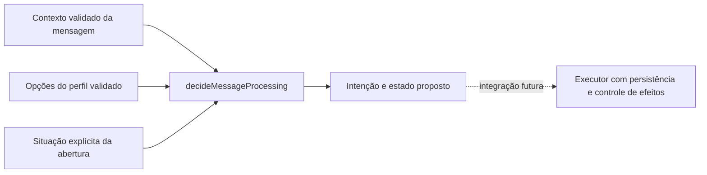

# Etapa 4.15 — Decisão de processamento por estado

Preparada em 13/11/2026 na branch `feat/message-processing-decision`, sobre a etapa 4.14 enviada para revisão. A entrega implementa uma decisão pura: recebe contexto, opções do perfil e situação da abertura; retorna uma intenção de processamento.

**Validação executada:** `npm run check` passou em tipos, compilação e **93 registros sem banco**, com zero falhas, cancelamentos ou ignorados. São 15 testes novos. A suíte PostgreSQL não foi repetida, pois nenhum caminho de persistência ou script de integração mudou; o último resultado é de 111 registros na etapa 4.13.

Não houve acesso ao PostgreSQL, uso do Docker, instalação de dependências, migrações ou alterações de credenciais. A entrega fica local para revisão, sem commit ou push.

## 1. Objetivo e arquitetura

A decisão responde: **o que fazer com esta mensagem neste estado?** Ela não executa a ação. Por exemplo, retornar `solicitar_recepcao` propõe um encaminhamento, mas não cria o lead ou modifica a conversa.



A regra pertence à aplicação do módulo `messaging`. Ela usa somente contratos internos: não importa Express, PostgreSQL, sistema de arquivos ou cliente de IA. A dependência entre módulos passa pelo contrato de `business-profile`; o leitor JSON não é importado. O perfil precisa fornecer apenas `menuOptions` para esta decisão.

O resultado é uma união discriminada por `action`. Cada variante permite somente os campos que fazem sentido para aquela intenção. Como é um valor produzido pelo próprio código, e não uma nova entrada externa, o contrato é um tipo TypeScript; a validação Zod continua nas fronteiras que carregam contexto e perfil. A função pressupõe essas entradas já validadas, sem repetir as leituras ou os schemas.

## 2. Fluxo de revisão por dependência

Os caminhos abaixo pertencem a `apps/api`, salvo indicação contrária.

| Ordem | Arquivo | Responsabilidade e pontos de revisão |
|---|---|---|
| 1 | [contracts/message-processing-context.ts](../apps/api/src/modules/messaging/contracts/message-processing-context.ts) e [contrato do perfil](../apps/api/src/modules/business-profile/contracts/business-profile.ts), existentes | Relembrar os seis estados, direção, remetente, corpo nulo e ações configuradas do menu |
| 2 | [contracts/message-processing-decision.ts](../apps/api/src/modules/messaging/contracts/message-processing-decision.ts) | Definir intenções, motivos de silêncio/adiamento e estados propostos. Conferir que a recepção usa Novo e `needsReview: false` |
| 3 | [application/decide-message-processing.ts](../apps/api/src/modules/messaging/application/decide-message-processing.ts) | Conferir filtros, prioridade dos estados, abertura explícita, menu configurável e tratamento exaustivo das variantes |
| 4 | [application/decide-message-processing.test.ts](../apps/api/src/modules/messaging/application/decide-message-processing.test.ts) | Revisar a matriz de comportamentos e os limites da interpretação de texto. Os dados são sintéticos e independem do JSON de demonstração |
| 5 | [package.json da API](../apps/api/package.json) | Conferir inclusão do novo arquivo no comando de testes sem banco. Não há dependências novas |
| 6 | READMEs, [fluxo](03-fluxo-e-ciclo-de-vida.md), [contratos](05-contratos-de-dados.md), [histórico](07-fluxo-de-desenvolvimento.md) e [guia anterior](22-etapa-4-perfil-do-negocio.md) | Conferir o escopo e distinguir decisões disponíveis de efeitos ainda pendentes |

## 3. Entradas e abertura do ciclo

`MessageProcessingDecisionInput` exige:

- `context`: contexto interno da etapa 4.13, já validado.
- `profile`: opções do perfil validado na etapa 4.14.
- `openingStatus`: `pendente` ou `enviada`, obrigatório e sem valor padrão.

O estado `aguardando_menu` não informa se a abertura já aconteceu. Por isso, a função exige uma indicação separada e não consulta mensagens anteriores, datas ou o tempo de inatividade para adivinhar esse fato. O contexto existente não ganhou um campo fictício que o banco ainda não sabe fornecer.

O futuro executor terá que obter essa indicação de um controle persistido e coerente com a conversa, antes de usar a função. Ainda não existe esse controle nesta entrega. A abertura pendente só é consultada em `aguardando_menu`; ela não reabre estados humanos ou encerrados nem reinicia a conversa que já aguarda detalhes.

Com abertura pendente, a primeira mensagem elegível propõe `enviar_abertura`, mesmo quando seu texto é `1`, `2` ou `3`. Esse evento inicia a interação; a escolha será interpretada em uma mensagem posterior, após a abertura. O envio único depende de persistência, concorrência e idempotência, não desta função pura.

## 4. Regras e prioridade

Primeiro, a função filtra mensagens que não são texto recebido do contato:

| Condição | Resultado |
|---|---|
| Direção diferente de `entrada` ou remetente diferente de `contato` | `ignorar / mensagem_nao_recebida_do_contato` |
| Áudio ou outro tipo | `ignorar / midia_nao_processavel` |
| Corpo nulo, vazio ou somente espaços | `ignorar / texto_vazio` |

Esses filtros não alteram a persistência da recepção. Uma mídia registrada continua registrada, e não passa a gerar job. Após os filtros, vale o estado atual:

| Estado e condição | Intenção | `nextStatus` proposto |
|---|---|---|
| `aguardando_menu`, abertura pendente | `enviar_abertura` | `aguardando_menu` |
| `aguardando_menu`, ação configurada de serviços | `informar_servicos` | `aguardando_detalhes` |
| `aguardando_menu`, ação configurada de valores/horários | `informar_valores_horarios` | `aguardando_detalhes` |
| `aguardando_menu`, ação configurada de recepção | `solicitar_recepcao` | `aguardando_humano` |
| `aguardando_menu`, número não configurado | `reapresentar_menu` | `aguardando_menu` |
| `aguardando_menu`, texto livre | `solicitar_qualificacao` | `qualificando` |
| `aguardando_detalhes`, qualquer texto elegível | `solicitar_qualificacao` | `qualificando` |
| `qualificando` | `adiar / qualificacao_em_andamento` | Sem transição |
| `aguardando_humano` | `ignorar / aguardando_humano` | Sem transição |
| `em_atendimento_humano` | `ignorar / em_atendimento_humano` | Sem transição |
| `encerrada` | `ignorar / conversa_encerrada` | Sem transição |

O menu procura o número na configuração e usa sua ação; não fixa os significados nos números 1, 2 e 3. Os testes também usam 7, 8 e 9, com outra ordem e outros rótulos.

Espaços externos são retirados somente para interpretação, preservando o corpo original. Uma sequência formada exclusivamente por dígitos ASCII é uma escolha numérica: `0`, `01`, `99` ou um número muito grande não configurado reapresentam o menu. Não há conversão para `Number`, então `01` não vira `1`.

Outros textos seguem como texto livre, incluindo `opção 1`, `1.5`, `-1` e `1 ou 2?`. Não há interpretação semântica ou extração de número dentro de frases. Em `aguardando_detalhes`, inclusive `1` e `3` são conteúdo da resposta, sem reexecutar o menu.

`solicitar_recepcao` inclui a intenção de lead com `stage: novo` e `needsReview: false`, sem inventar resumo, confiança ou resultado de IA. `solicitar_qualificacao` apenas identifica a necessidade de qualificação: provedor, modelo, API, prompt e credenciais de IA continuam indefinidos.

## 5. Adiamento e limites para o executor

`adiar` é diferente de `ignorar`: uma mensagem elegível recebida em `qualificando` deve poder ser reconsiderada depois, sem iniciar outra qualificação concorrente. A decisão não define horário de reagendamento, incremento de tentativas ou uso de `fail()`, e não muda a política de retry. O futuro executor não deverá concluir o job como se essa mensagem tivesse sido processada. A estratégia de adiamento e ordenação por conversa precisa ser resolvida antes de ativar o consumo.

`nextStatus` é uma proposta associada à intenção, não uma confirmação de transição. A futura execução precisará validar a tentativa do job e o estado vigente da conversa, coordenar persistência com os efeitos e impedir duplicações. O contexto consultado é uma fotografia; a decisão não constitui bloqueio ou autorização de envio.

A função não implementa o ciclo completo da máquina de estados: assumir atendimento, concluir qualificação e encerrar conversa são outros eventos. O `switch` exaustivo usa `never` para o compilador apontar estados ou ações novos que ainda não foram tratados.

Composição das mensagens, cálculo do expediente no fuso da clínica, controle persistido da abertura, criação de leads, chamada à IA, envio ao simulador/WhatsApp e integração com jobs/worker permanecem pendentes. Não houve alteração do webhook ou de seu comportamento observável no Postman.

## 6. Testes e comandos

Os 15 testes cobrem abertura pendente e já enviada, serviços, valores, recepção, números/ordem/rótulos configuráveis, espaços, escolha numérica inválida, texto livre, detalhes, adiamento durante qualificação, silêncio nos três estados protegidos, direção/remetente, mídias, texto ausente e determinismo sem mutação das entradas ou compartilhamento dos objetos retornados.

Na raiz, para verificar a entrega e os testes anteriores sem banco:

```powershell
npm run check
```

Resultado observado: **93 aprovados**, zero falhas, cancelamentos e ignorados, além de tipos e compilação. Para executar apenas os 15 testes novos:

```powershell
npm run build --workspace=@copilot-leads/api
node --test apps/api/dist/modules/messaging/application/decide-message-processing.test.js
```

Não é necessário iniciar a API, Docker ou PostgreSQL, nem executar migrações. A suíte PostgreSQL anterior não foi repetida nesta entrega; seus 111 registros aprovados pertencem à validação da etapa 4.13.

## 7. Próxima parte

Preparar a composição dos textos predefinidos com o perfil e o cálculo do expediente no fuso configurado. Depois, definir persistência da abertura, ordenação por conversa, adiamento e idempotência antes de conectar as decisões à execução real. A revisão em paralelo pode trazer ajustes às entregas anteriores ou a esta.
