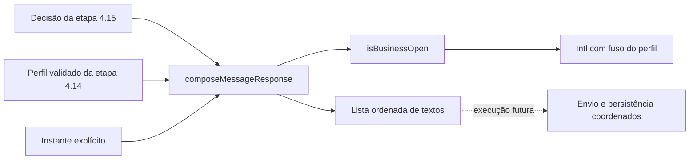

# Etapa 4.16 — Composição de mensagens e expediente

Preparada em 16/11/2026 na branch `feat/message-composition`, sobre a etapa 4.15 enviada para revisão. A entrega compõe os textos predefinidos usando o perfil validado e calcula o expediente para um instante explícito no fuso do negócio.

**Validação executada:** `npm run check` passou em tipos, compilação e **115 registros sem banco**, sem falhas, cancelamentos ou ignorados. São 22 testes novos: dez de expediente e doze de composição.

Não houve acesso ao PostgreSQL, uso do Docker, instalação de dependências, migrações ou alterações de credenciais. A suíte PostgreSQL não foi repetida, pois seus caminhos e script não mudaram; o último resultado é de 111 registros na etapa 4.13. Após autorização, os commits `393381a`, `43857f6` e `14da32c` foram enviados para `origin/feat/message-composition`, com upstream e sincronização conferidos. Os testes não foram repetidos durante os commits. Não houve merge ou PR; a revisão técnica permanece em paralelo.

## 1. Responsabilidades e arquitetura



`isBusinessOpen` pertence à aplicação de `business-profile`, pois interpreta o expediente configurado do negócio. `composeMessageResponse` pertence à aplicação de `messaging`, pois traduz a intenção de resposta em textos. Ele chama a regra pública de expediente e usa o contrato do perfil, sem importar o leitor JSON ou qualquer infraestrutura do outro módulo.

As funções recebem seus dados e não consultam relógio, banco, arquivos ou APIs. A composição não muda a decisão, o perfil ou o instante recebido. O resultado é uma lista nova de strings em cada chamada. Ela representa o conteúdo e a ordem propostos, sem confirmar envio, entrega, transição de estado ou conclusão de job.

## 2. Fluxo de revisão por dependência

Os caminhos abaixo pertencem a `apps/api`.

| Ordem | Arquivo | Responsabilidade e pontos de revisão |
|---|---|---|
| 1 | [contrato do perfil](../apps/api/src/modules/business-profile/contracts/business-profile.ts) e [contrato de decisão](../apps/api/src/modules/messaging/contracts/message-processing-decision.ts), existentes | Relembrar faixas no mesmo dia, dias 0–6, centavos nulos ou inteiros seguros, textos-base e intenções |
| 2 | [business-profile/application/is-business-open.ts](../apps/api/src/modules/business-profile/application/is-business-open.ts) | Converter o instante para dia/hora no fuso configurado e aplicar início incluído/fim excluído |
| 3 | [is-business-open.test.ts](../apps/api/src/modules/business-profile/application/is-business-open.test.ts) | Conferir fronteiras, almoço, dias fechados, meia-noite, mudança de data, horário de verão e independência do fuso do processo |
| 4 | [messaging/application/compose-message-response.ts](../apps/api/src/modules/messaging/application/compose-message-response.ts) | Compor cada intenção, ordenar os horários, apresentar preços e preservar silêncio onde não há resposta prevista |
| 5 | [compose-message-response.test.ts](../apps/api/src/modules/messaging/application/compose-message-response.test.ts) | Conferir textos e ordem exatos, aviso apenas na abertura, valores nulos/zero/limite e ausência de mutação |
| 6 | [package.json](../apps/api/package.json) | Conferir inclusão dos dois arquivos na suíte sem banco. Dependências e integração PostgreSQL não mudaram |
| 7 | READMEs, [arquitetura](02-decisoes-de-arquitetura.md), [fluxo](03-fluxo-e-ciclo-de-vida.md), [contratos](05-contratos-de-dados.md), [histórico](07-fluxo-de-desenvolvimento.md) e [guia anterior](23-etapa-4-decisao-de-processamento.md) | Verificar regras confirmadas, limites desta entrega e distinção entre composição e execução |

## 3. Regra de expediente

`isBusinessOpen(profile, at)` recebe somente `timezone` e `openingHours` do perfil, além de um `Date` obrigatório. Um instante inválido lança `RangeError` com a mensagem `Instante de expediente inválido.`, em vez de assumir aberto ou fechado.

O perfil já deve ter sido validado pelo schema da etapa 4.14. A função não revalida todas as faixas ou tenta corrigir configurações inválidas. Ela aplica estas regras:

- Dia da semana local de domingo = 0 até sábado = 6.
- Horário local interpretado no fuso do perfil, independentemente do fuso padrão do servidor.
- Cada faixa tem início incluído e fim excluído: `start <= horaLocal < end`.
- Um dia sem faixas está fechado; lista vazia significa todos os dias fechados.
- Basta uma faixa correspondente. Intervalos de almoço ficam fechados e faixas adjacentes não criam lacunas.

Para o perfil de demonstração, segunda a sexta abre às 08:00, fecha às 12:00, reabre às 13:00 e fecha às 18:00. O minuto anterior ao fechamento continua aberto até o fim; o instante exato do fechamento já está fora da faixa.

`Intl.DateTimeFormat` usa `timeZone` explícito e `formatToParts`, sem interpretar uma string formatada como nova data ou subtrair manualmente um offset UTC. O ciclo `h23` representa meia-noite como `00`. O locale interno `en-US` estabiliza os identificadores de dia usados no cálculo, e não determina o idioma dos textos apresentados ao usuário.

O cálculo usa o dia e minuto locais do instante recebido. As faixas do contrato têm precisão de minuto. Horas locais repetidas no fim do horário de verão pertencem à faixa em ambas as ocorrências; horas saltadas não geram instantes artificiais. Os testes usam exemplos fixos de `America/New_York`, além dos fusos de São Paulo, Tóquio e UTC.

Feriados, exceções por data e faixas que atravessam meia-noite continuam fora do contrato. A decisão sobre qual instante usar em produção — chegada, persistência ou processamento — permanece para a integração: o compositor não escolhe silenciosamente entre eles.

## 4. Textos produzidos

`composeMessageResponse(decision, profile, at)` recebe a decisão da etapa 4.15 e um perfil completo já validado. `at` é obrigatório e só é consultado para compor a abertura. O retorno é `string[]`, com um bloco por item:

| Intenção | Blocos retornados, nesta ordem |
|---|---|
| `enviar_abertura`, dentro do expediente | Nome e saudação; menu |
| `enviar_abertura`, fora do expediente | Nome e saudação; aviso com horários; menu |
| `reapresentar_menu` | Texto de opção inválida; menu |
| `informar_servicos` | Introdução com nomes e descrições; pergunta sobre o serviço |
| `informar_valores_horarios` | Introdução com preços e horários; pergunta sobre solicitação de agendamento |
| `solicitar_recepcao`, `solicitar_qualificacao`, `ignorar`, `adiar` | Lista vazia |

Lista vazia significa apenas que essa intenção não tem texto automático nesta entrega. Ela não transforma encaminhamento, qualificação ou adiamento em sucesso ou descarte. Esses efeitos continuam necessários no futuro executor.

Nome, textos-base, serviços, preços e opções vêm do perfil. O menu preserva a ordem, os números e os rótulos configurados; não fixa 1, 2 e 3. A composição preserva quebras de linha dos textos-base e acrescenta separadores previsíveis entre as partes estruturadas. Os rótulos genéricos de apresentação, como `Fechado` e `Valor não informado`, ficam no compositor em português brasileiro; não são dados específicos da clínica.

Os horários são apresentados de segunda a domingo, com faixas ordenadas pelo início e dias ausentes como `Fechado`. O título informa o fuso. A ordenação usa cópias, sem alterar a ordem do JSON ou do perfil carregado. Semana vazia mostra sete dias fechados; a abertura ainda oferece o menu, conforme D17.

O aviso fora do expediente só acompanha `enviar_abertura`. Reapresentar menu ou responder sobre serviços/valores fora do expediente não repete esse aviso. Garantir que a abertura seja enviada uma única vez continua dependendo do controle persistido, da concorrência e da idempotência do futuro executor.

Preços são apresentados em BRL com duas casas decimais, a partir de centavos. `null` aparece como `Valor não informado`, sem inventar cobrança ou tratar ausência como gratuidade; zero aparece como `R$ 0,00`. A implementação usa `BigInt` para separar a parte inteira dos centavos e `Intl.NumberFormat.formatToParts` para a apresentação. Isso preserva centavos até `Number.MAX_SAFE_INTEGER`, limite já aceito pelo contrato, sem perdas causadas pela divisão em ponto flutuante. O espaço entre `R$` e o valor é o espaço não separável produzido pelo `Intl`.

Referências primárias: [Intl.DateTimeFormat.formatToParts](https://tc39.es/ecma402/#sec-intl.datetimeformat.prototype.formattoparts) e [Intl.NumberFormat.formatToParts](https://tc39.es/ecma402/#sec-intl.numberformat.prototype.formattoparts).

## 5. Testes e determinismo

Os dez testes de expediente verificam fronteiras exatas (inclusive um milissegundo antes), almoço, dias ausentes e semana vazia, todos os dias da semana, faixas adjacentes/desordenadas, mudança de data entre UTC e o fuso local, meia-noite, transições de horário de verão, instante inválido e fusos padrão diferentes do processo.

O último cenário inicia processos Node com `TZ` em UTC, Honolulu e Tóquio e confirma os mesmos resultados para o expediente de São Paulo. A suíte não altera o fuso global do processo de testes. Não há `setTimeout`, atrasos artificiais, `Date.now()` ou consulta ao relógio atual: os instantes estão explícitos nas fixtures sintéticas.

Os doze testes de composição verificam abertura dentro/fora do expediente, almoço e dia fechado, opção inválida, serviços, preços/horários, preço ausente/zero/limite, semana vazia, intenções sem resposta, textos alternativos e ordem configurada, determinismo/listas independentes e abertura com instante inválido.

Para verificar tudo na raiz:

```powershell
npm run check
```

Resultado observado: tipos e compilação aprovados, **115 registros aprovados**, zero falhas, cancelamentos ou ignorados. Para executar apenas os 22 testes novos:

```powershell
npm run build --workspace=@copilot-leads/api
node --test apps/api/dist/modules/business-profile/application/is-business-open.test.js apps/api/dist/modules/messaging/application/compose-message-response.test.js
```

Não é necessário iniciar a API, Docker ou PostgreSQL, nem executar migrações. Os 111 registros de integração PostgreSQL citados no histórico pertencem à etapa 4.13 e não foram executados nesta entrega.

## 6. Limites e próxima parte

As funções não estão ligadas ao webhook, ao ponto de entrada da API ou ao consumo de jobs. Não há envio, persistência de respostas, transição de conversa, criação de lead ou chamada à IA. A API ainda não apresenta essas respostas no Postman. Também não foram definidos limites de tamanho ou divisão dos blocos para um provedor real de mensagens.

A próxima preparação deve definir o controle persistido da abertura e dos efeitos de resposta, junto da ordenação por conversa e do adiamento. Será necessário coordenar estado, reserva atual do job e idempotência antes de ativar o executor/worker. Essa integração também deverá escolher o instante de referência usado na verificação de expediente. Provedor e modelo de IA continuam para sua entrega própria.

O primeiro recorte da etapa 4.17 define a modelagem e os contratos desse plano, ainda sem banco. A referência inicial escolhida é a data de persistência da mensagem. O [documento 25](25-etapa-4-contrato-do-plano-de-resposta.md) apresenta a proposta, as limitações e a ordem de revisão.
