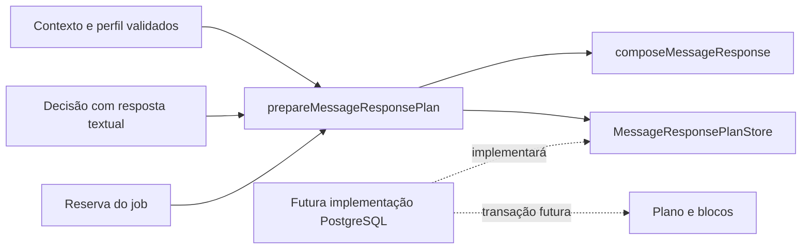
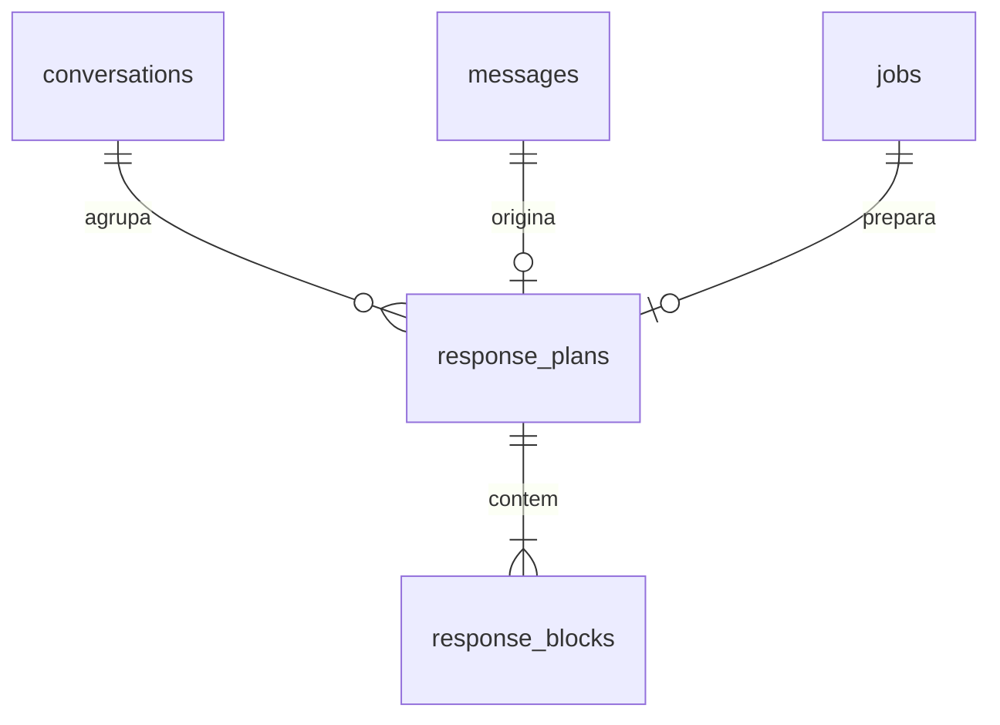

# Etapa 4.17 — Contrato e modelagem do plano de resposta

Preparada em 16/11/2026 na branch `feat/response-plan-contract`, sobre a etapa 4.16 enviada para revisão. Este é o primeiro recorte do controle persistido: modelo proposto, schema do rascunho, porta de gravação e caso de uso que monta o plano. **A implementação PostgreSQL e as migrações ainda não fazem parte desta entrega.**

**Validação executada:** `npm run check` passou em tipos, compilação e **131 registros sem banco**, sem falhas, cancelamentos ou ignorados. São 16 testes novos: seis de contrato e dez de aplicação. A suíte PostgreSQL não foi repetida; os caminhos e o script de integração não mudaram. Seu último resultado é de 111 registros na etapa 4.13.

Não houve acesso ao PostgreSQL, uso do Docker, migrações, novas dependências ou alterações de credenciais. O caso de uso ainda não está conectado à API ou ao worker. Após autorização, os commits `81ee7eb` e `f2e4fc7` foram enviados para `origin/feat/response-plan-contract`, com upstream e sincronização conferidos. Os arquivos foram preservados e os testes não foram repetidos durante os commits. Não houve merge ou PR; a revisão técnica permanece em paralelo.

## 1. O problema e o recorte

Decidir uma ação e montar seus textos não basta para retomar um processamento interrompido: é preciso lembrar qual resposta foi preparada, seus blocos, sua origem e o progresso do envio. Recalcular os textos depois de alterar o perfil não deve substituir um plano que já foi salvo.

O plano será o registro durável dessa intenção de resposta. Ele não é uma mensagem entregue ao provedor e não substitui a tabela `messages`. Uma mensagem de saída confirmada poderá ser registrada nessa tabela e vinculada ao bloco correspondente, em uma entrega posterior.

Nesta etapa implementamos a parte que independe do banco: o contrato do rascunho e sua preparação. A transação, a exclusão mútua e a idempotência persistida são **obrigações especificadas para a futura implementação**, não garantias já demonstradas pelos testes atuais.

## 2. Responsabilidades no monólito modular



O módulo `messaging` é responsável pelo plano. A aplicação conhece o tipo da reserva de `jobs`, o contrato do perfil e a porta de persistência. Ela não importa `pg`, sistema de arquivos ou ferramentas de migração. O schema Zod fica em `contracts`, com tipo derivado. O pacote `shared` permanece inalterado, pois não é um contrato do painel.

Não foi criado um repositório em memória para simular garantias de banco. Os substitutos dos testes somente capturam comandos e devolvem resultados programados; não comprovam bloqueios, unicidade, rollback ou ausência de duplicatas reais.

## 3. Fluxo de revisão por dependência

Os caminhos abaixo pertencem a `apps/api/src/modules/messaging`, salvo indicação contrária.

| Ordem | Arquivo | Responsabilidade e pontos de revisão |
|---|---|---|
| 1 | Seções 4–7 deste documento | Revisar identidade do plano, abertura preparada/enviada, ordem dos blocos e responsabilidades da futura transação |
| 2 | [contracts/message-response-plan.ts](../apps/api/src/modules/messaging/contracts/message-response-plan.ts) | Schema estrito e tipo do rascunho: origem, estado esperado, decisão, instante e blocos consecutivos |
| 3 | [contracts/message-response-plan.test.ts](../apps/api/src/modules/messaging/contracts/message-response-plan.test.ts) | Conferir campos inválidos, textos preservados, posições e correspondência entre ação e próximo estado |
| 4 | [application/message-response-plan-store.ts](../apps/api/src/modules/messaging/application/message-response-plan-store.ts) | Definir a operação atômica e diferenciar novo plano, existente, perda da reserva, contexto alterado e adiamento |
| 5 | [application/prepare-message-response-plan.ts](../apps/api/src/modules/messaging/application/prepare-message-response-plan.ts) | Conferir vínculo da reserva, elegibilidade do texto, referência temporal, composição e entrega única do rascunho à porta |
| 6 | [application/prepare-message-response-plan.test.ts](../apps/api/src/modules/messaging/application/prepare-message-response-plan.test.ts) | Conferir o comando montado, resultados de conflito/adiamento, propagação de falha e preservação das entradas |
| 7 | [package.json da API](../apps/api/package.json) | Inclusão dos dois arquivos no comando sem banco; dependências e script de integração não mudaram |
| 8 | READMEs, [arquitetura](02-decisoes-de-arquitetura.md), [fluxo](03-fluxo-e-ciclo-de-vida.md), [modelagem](04-modelagem-de-dados.md), [contratos](05-contratos-de-dados.md), [histórico](07-fluxo-de-desenvolvimento.md) e [guia anterior](24-etapa-4-composicao-de-mensagens.md) | Distinguir o modelo proposto das tabelas existentes e das garantias ainda pendentes |

## 4. Identidade, conteúdo e referência temporal

O rascunho `MessageResponsePlanDraft` contém:

| Campo | Regra |
|---|---|
| `messageId` | UUID interno da mensagem de origem, não o ID do provedor |
| `conversationId` | UUID da conversa original dessa mensagem |
| `expectedStatus` | `aguardando_menu`, estado exigido para criar os planos deste recorte |
| `decision` | Ação e próximo estado compatíveis: abertura/menu → menu; serviços/valores → detalhes |
| `referenceAt` | `Date` válido, copiado de `message.createdAt` |
| `blocks` | Lista não vazia de `{ position, text }`, com posições 1, 2, … N na ordem do array |

O schema rejeita campos desconhecidos, IDs/datas inválidos, texto vazio, posições repetidas, lacunas e ações sem resposta textual. Preserva espaços e quebras de linha dos textos válidos. Não tenta validar semântica de frases ou reconhecer se alguém forneceu um menu completo; o caso de uso usa o compositor da etapa 4.16 para montar o conjunto de blocos.

O caso de uso recebe uma decisão restrita a `enviar_abertura`, `reapresentar_menu`, `informar_servicos` ou `informar_valores_horarios`. Recepção, qualificação, silêncio e adiamento continuam em seus próprios fluxos; não geram planos vazios aqui. Os dados de entrada são contratos internos já validados nas respectivas fronteiras. O futuro store deverá validar o rascunho ao receber dados na sua fronteira de persistência.

**Escolha inicial para o expediente:** a referência é a data de persistência da mensagem, atualmente o instante estável disponível por mensagem. Não é a data original do provedor nem o horário de reserva/execução do job. Uma mensagem registrada às 09:00 e processada à noite usa 09:00 nessa regra. Essa escolha está explícita e pode ser revisada antes da ativação do executor; não foi acrescentada uma coluna de chegada nesta etapa.

O rascunho recalculado usa o perfil fornecido na chamada. Se já existir plano persistido, seu conteúdo original deverá prevalecer: a porta retorna o ID existente e não substitui blocos, decisão ou referência temporal. O resultado não devolve uma cópia recém-gerada como se fosse o plano salvo. A futura leitura do plano original será necessária para retomada/envio, inclusive quando a nova decisão por estado já não tiver resposta textual; essa orquestração ainda não foi implementada.

## 5. Modelo relacional proposto — tabelas ainda inexistentes



### response_plans

| Coluna proposta | Finalidade |
|---|---|
| `id` | UUID do plano, gerado na persistência |
| `conversation_id`, `source_message_id`, `source_job_id` | Vínculos com conversa, mensagem e job de origem |
| `action` | Uma das quatro ações textuais do contrato |
| `expected_status`, `next_status` | Estado exigido na preparação e estado proposto após os efeitos |
| `reference_at` | Instante usado para compor o expediente |
| `status` | `pendente`, `enviado` ou `cancelado`; começa pendente |
| `created_at`, `finished_at` | Auditoria da preparação e término; término nulo enquanto pendente |

O contador da tentativa é uma condição da operação, não a identidade do plano. Uma nova tentativa do mesmo job deve reconhecer o mesmo plano. `source_message_id` será único em todos os estados, inclusive após envio ou cancelamento. Uma abertura terá também unicidade por conversa, em todos os estados: cancelar não autoriza criar outra abertura automaticamente.

A proposta limita a um plano `pendente` por conversa. Esse estado inclui um envio parcial, se já houver blocos confirmados; não significa que nenhum bloco foi enviado. Enviar, cancelar ou retomar planos ainda não são operações desta porta.

### response_blocks

| Coluna proposta | Finalidade |
|---|---|
| `plan_id`, `position` | Chave composta; posição positiva e única dentro do plano |
| `text` | Conteúdo não vazio, congelado após a preparação |
| `status` | `pendente`, `enviado` ou `cancelado` para acompanhar o progresso futuro |
| `sent_message_id`, `sent_at` | Referência à mensagem de saída confirmada e instante de confirmação, quando houver |

O estado do plano e dos blocos **não foi incluído no rascunho de criação**, que contém somente a intenção a preparar. Suas transições e contratos de leitura/confirmação serão implementados na entrega de execução. Cancelar um plano parcialmente enviado não desfaz o que já foi entregue.

### Restrições e verificações planejadas

- FKs para os registros de origem, com exclusão restringida enquanto houver plano. A migração deverá garantir também os vínculos compostos mensagem/conversa e job/mensagem, evitando tratar duas FKs independentes como prova dessa correspondência.
- Unicidade da mensagem de origem; índice único parcial da abertura por conversa; índice único parcial do plano pendente por conversa.
- Checks de ação/estado, datas de término e posições positivas, combinados com campos obrigatórios.
- Plano e todos os blocos gravados juntos. A sequência completa de posições e a existência de pelo menos um bloco precisam de validação e transação; não serão tratadas como um `CHECK` simples entre linhas.

Essas restrições ainda são uma proposta para a migração. Referências primárias: [restrições no PostgreSQL](https://www.postgresql.org/docs/18/ddl-constraints.html) e [bloqueios de linha](https://www.postgresql.org/docs/18/explicit-locking.html#LOCKING-ROWS).

## 6. Abertura preparada não significa enviada

| Situação persistida futura | Conduta prevista |
|---|---|
| Nenhum plano de abertura | Primeira preparação pode reservar a abertura sob proteção transacional |
| Abertura pendente, inclusive com envio parcial | Outra mensagem aguarda; não cria segunda abertura nem avança menu |
| Abertura enviada por completo | Mensagens posteriores podem seguir o menu, respeitando estado atual e outros planos pendentes |
| Abertura cancelada | Não assumir enviada nem recriar automaticamente; encaminhar para tratamento explícito na execução futura |

O booleano implícito não basta. A entrada `openingStatus` do decisor da etapa 4.15 continua `pendente | enviada`, mas a futura orquestração deverá tratar preparação pendente/cancelamento **antes de chamá-lo**. Não pode traduzir uma abertura apenas preparada como `enviada`. O contrato anterior não foi alterado ou conectado a dados fictícios de banco.

Na proposta, criar o plano mantém `conversations.status` inalterado. Aplicar `next_status` só deverá acontecer na execução coordenada, após confirmação de todos os blocos necessários e nova verificação do estado da conversa. Se um humano assumir ou a conversa encerrar nesse intervalo, o executor deverá respeitar o silêncio e tratar o plano pendente; essa transição não é implementada aqui.

## 7. Porta atômica e concorrência a implementar

`MessageResponsePlanStore.prepare({ attempt, draft })` retorna:

| Resultado | Significado contratual |
|---|---|
| `preparado / planId` | Novo plano e todos os blocos confirmados pela futura transação |
| `existente / planId` | Já há plano da mensagem; preservar e consultar o original |
| `reserva_desatualizada` | Job não corresponde mais a ID + contador + `processando` |
| `contexto_desatualizado` | Vínculos, elegibilidade, estado esperado ou situação da abertura impedem nova preparação |
| `adiado / abertura_pendente` | Outra mensagem ainda aguarda o término da abertura |
| `adiado / resposta_anterior_pendente` | Outra resposta da conversa ainda está pendente |

Após validar a entrada, a implementação deverá bloquear e conferir o job e a conversa, seguindo uma ordem consistente em todas as futuras operações que precisarem dos dois. Primeiro deverá conferir a tentativa e os vínculos de origem. Depois, com tentativa válida, procurar um plano existente **antes** de exigir `aguardando_menu` para um plano novo. Assim, uma retomada não perde o original porque o estado da conversa já avançou.

O caso de uso não recusa a fotografia de uma conversa já em outro estado antes de consultar a porta. Isso permite receber `existente`; não autoriza uma criação nesse estado. A releitura protegida do estado para uma criação pertence à futura transação, que pode devolver `contexto_desatualizado`.

Para nova preparação, a porta deverá conferir estado/elegibilidade atuais e abertura, adiar diante de plano pendente conflitante, e inserir plano e blocos na mesma transação. Qualquer falha desfaz tudo. A tentativa antiga não poderá inserir um plano após recuperação ou nova reserva. Expiração de 120 segundos sozinha continua sem revogar a tentativa, conforme a etapa 4.12.

Adiar não significa falha definitiva nem sucesso. Este caso de uso não chama `complete()` ou `fail()`, não modifica contadores e não define atraso. O futuro executor precisará resolver o reagendamento sem consumir indevidamente tentativas. Indisponibilidade da porta rejeita a Promise, sem informar preparação bem-sucedida.

**Ordem:** as posições definem a ordem dos blocos de um plano. Limitar planos pendentes serializa respostas preparadas, mas não garante FIFO entre mensagens cujos jobs ainda não foram preparados. A política de ordenação por conversa e seu apoio no banco precisam ser concluídos antes do worker; a ordem de seleção de jobs da etapa 4.10 não oferece essa garantia sozinha.

O envio de um bloco só deverá avançar após confirmar os anteriores. Ainda será necessário tratar a queda entre enviar ao provedor e registrar a confirmação, usando as capacidades de idempotência do adapter/provedor. Unicidade de plano e checkpoints locais não comprovam entrega externa exatamente uma vez.

## 8. Validação e próximos passos

Os seis testes de contrato verificam snapshot sem transformação, IDs/datas/campos, conteúdo não vazio, posições consecutivas, ação/próximo estado e estado esperado. Os dez testes de aplicação verificam o comando completo, referência temporal, ações textuais, reconhecimento do resultado existente, conflitos/adiamentos, falhas, mensagem de outra reserva, contadores inválidos, mensagens não elegíveis e independência das entradas.

Na raiz:

```powershell
npm run check
```

Resultado observado: tipos e compilação aprovados, **131 registros aprovados**, zero falhas, cancelamentos ou ignorados. Para executar somente os 16 novos:

```powershell
npm run build --workspace=@copilot-leads/api
node --test apps/api/dist/modules/messaging/contracts/message-response-plan.test.js apps/api/dist/modules/messaging/application/prepare-message-response-plan.test.js
```

Não é necessário iniciar API, Docker ou PostgreSQL. Os testes não enviam mensagens nem executam migrações. O resultado `existente` e os conflitos são respostas de substitutos, não evidência de idempotência ou concorrência real no banco.

Após a revisão deste modelo, a próxima entrega deverá criar e testar as migrações das tabelas propostas em banco descartável. Depois virá a implementação PostgreSQL da porta, com testes de corrida, rollback, reserva antiga, preservação do snapshot e planos conflitantes. Somente as entregas posteriores conectarão leitura do plano original, confirmação dos blocos, transições, ordenação, adiamento e consumo automático. Não há envio ou integração de IA nesta etapa.

A migração está preparada na etapa 4.18 e foi verificada somente em bancos descartáveis, ainda sem implementar a porta. Os blocos ganharam `conversation_id` para proteção estrutural da conversa do plano e da mensagem confirmada. O [documento 26](26-etapa-4-migracao-dos-planos-de-resposta.md) apresenta os ajustes do modelo e o fluxo de revisão.
