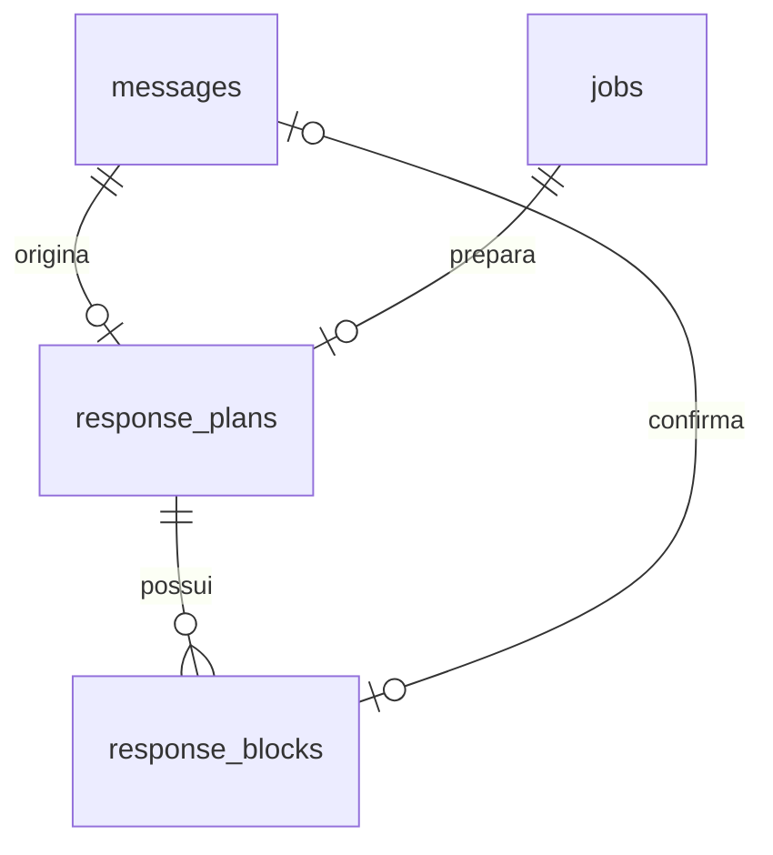

# Etapa 4.18 — Migração dos planos e blocos de resposta

Preparada em 16/11/2026 na branch `feat/response-plans-migration`, sobre a etapa 4.17 enviada para revisão. A entrega acrescenta uma migração SQL com `response_plans`, `response_blocks` e as chaves únicas de apoio às referências compostas.

**Validação executada:** `npm run check` passou em tipos, compilação e **131 registros sem banco**. `npm run test:integration` passou em **131 registros**, incluindo 19 cenários novos e seu agrupador. Não houve falhas, cancelamentos ou ignorados.

O PostgreSQL existente no Docker estava saudável; não foi necessário iniciar, recriar ou atualizar o contêiner. A aplicação e a reversão do SQL ocorreram somente em bancos descartáveis. Consultas de leitura antes e depois encontraram as mesmas contagens e hashes de `contacts`, `conversations`, `messages`, `jobs` e `pgmigrations` no banco do projeto. As novas tabelas e chaves de apoio continuam ausentes desse banco. Não restaram bancos descartáveis.

Não houve instalação de dependências, alterações de credenciais, execução de `db:migrate` no banco do projeto, envio ou worker. As alterações permanecem locais para revisão, sem commit ou push.

## 1. Responsabilidade da entrega

A migração fornece integridade estrutural para o modelo da etapa 4.17. Não implementa a porta `MessageResponsePlanStore`, a transação de preparação ou a confirmação de envio. A aplicação continua dependendo de sua interface, sem importar SQL, `pg` ou o migrador.

As duas tabelas são criadas na mesma migração porque os blocos dependem do plano e ambos usam chaves compostas de apoio. O `Down` remove os blocos, depois os planos e somente então as duas chaves acrescentadas às tabelas antigas. Nenhuma migração anterior foi editada.

## 2. Fluxo de revisão por dependência

Os caminhos abaixo pertencem a `apps/api`, salvo indicação contrária.

| Ordem | Arquivo | Responsabilidade e pontos de revisão |
|---|---|---|
| 1 | [Modelo da etapa 4.17](25-etapa-4-contrato-do-plano-de-resposta.md), seções 4–7 | Relembrar origem do plano, preparação/envio, estados e exigências da futura transação |
| 2 | [1794787200000_create_response_plans.sql](../apps/api/migrations/1794787200000_create_response_plans.sql) | Revisar primeiro as chaves de apoio, depois planos/índices, blocos e ordem do `Down` |
| 3 | [response-plans-migration.integration.test.ts](../apps/api/src/infrastructure/database/response-plans-migration.integration.test.ts) | Conferir isolamento, fixtures sintéticas, restrições, corridas, rollback, reaplicação, reversão e limpeza |
| 4 | [postgres-job-queue.integration.test.ts](../apps/api/src/modules/jobs/infrastructure/postgres-job-queue.integration.test.ts), [postgres-job-lifecycle.integration.test.ts](../apps/api/src/modules/jobs/infrastructure/postgres-job-lifecycle.integration.test.ts), [postgres-job-recovery.integration.test.ts](../apps/api/src/modules/jobs/infrastructure/postgres-job-recovery.integration.test.ts) e [postgres-message-processing-context-reader.integration.test.ts](../apps/api/src/modules/messaging/infrastructure/postgres-message-processing-context-reader.integration.test.ts) | Única mudança em cada arquivo: listar também as duas novas tabelas no `TRUNCATE` do banco descartável |
| 5 | [package.json](../apps/api/package.json) | Conferir inclusão da nova suíte no script de integração. Testes sem banco e dependências não mudaram |
| 6 | READMEs, [arquitetura](02-decisoes-de-arquitetura.md), [fluxo](03-fluxo-e-ciclo-de-vida.md), [modelagem](04-modelagem-de-dados.md), [contratos](05-contratos-de-dados.md), [histórico](07-fluxo-de-desenvolvimento.md) e [guia anterior](25-etapa-4-contrato-do-plano-de-resposta.md) | Conferir o que o SQL garante e o que permanece para a implementação da porta/executor |

## 3. Vínculos e chaves compostas



`messages` ganha uma chave única em `(id, conversation_id)` e `jobs` em `(id, message_id)`. Seus IDs já são únicos pelas chaves primárias; as novas chaves tornam essas combinações referenciáveis por FKs. Os dados antigos não são reescritos. A migração adiciona restrições/índices, o que requer bloqueios na aplicação real; nesta entrega isso foi feito apenas em bancos descartáveis.

O plano referencia `(source_message_id, conversation_id)` de `messages` e `(source_job_id, source_message_id)` de `jobs`. Assim, não basta fornecer três IDs que existem: a mensagem precisa pertencer à conversa e o job precisa apontar para essa mensagem.

**Ajuste do modelo para os blocos:** foi acrescentado `conversation_id` à tabela `response_blocks`, derivado da conversa do plano. A chave única `(id, conversation_id)` do plano permite ligar o bloco à mesma conversa. A confirmação usa `(sent_message_id, conversation_id)` de `messages`, impedindo associar ao bloco uma mensagem de outra conversa. É uma redundância controlada para expressar essas correspondências no banco; não muda o rascunho público da aplicação.

As FKs usam `ON DELETE RESTRICT`. Um plano impede excluir suas origens; um bloco impede excluir seu plano ou a mensagem confirmada que referencia. Uma mensagem confirmada só pode ser usada por um bloco, mediante unicidade de `sent_message_id`; vários blocos pendentes podem manter esse campo nulo.

## 4. Planos, estados e índices

`response_plans` contém UUID gerado pelo banco, conversa/mensagem/job de origem, ação, estado esperado, próximo estado, referência temporal, status e datas de criação/término. O padrão é `pendente`, com `finished_at` nulo.

O estado esperado é `aguardando_menu`. As ações de abertura/reapresentação propõem o mesmo estado; serviços/valores propõem `aguardando_detalhes`. Outras ações ou combinações são recusadas pelo SQL. Isso valida o conteúdo do plano, não confirma que a conversa esteja atualmente nesse estado.

Os status aceitos são `pendente`, `enviado` e `cancelado`. Um plano terminado exige `finished_at`, com data finita e não anterior à criação. `reference_at` e `created_at` também precisam ser finitos; a referência é obrigatória e não tem um default que esconda sua origem.

As três unicidades têm responsabilidades distintas:

| Proteção | Regra |
|---|---|
| Mensagem de origem | Um plano por `source_message_id`, em todos os estados |
| Abertura | Índice único por conversa quando `action = enviar_abertura`, inclusive após envio/cancelamento |
| Resposta pendente | Índice único por conversa quando `status = pendente`; histórico terminado pode coexistir |

Os testes exercitam as três em inserções concorrentes. A violação de unicidade escolhe um vencedor estrutural, mas ainda não transforma o conflito em `existente` ou `adiado`: essa tradução pertence ao futuro store.

## 5. Blocos e confirmação

`response_blocks` usa a chave primária `(plan_id, position)`. A posição é um inteiro positivo; `text` é obrigatório e exige algum caractere fora da classe de espaços POSIX. O texto não é aparado ou transformado ao gravar. A validação Zod continua necessária na futura fronteira de persistência, inclusive porque o critério de espaços de JavaScript não é uma equivalência prometida da classe POSIX do PostgreSQL.

O bloco começa `pendente`, sem confirmação. Seus status são `pendente`, `enviado` e `cancelado`. `enviado` exige simultaneamente `sent_message_id` e `sent_at`; os demais exigem ambos nulos. Uma data de confirmação informada deve ser finita. Um plano parcialmente enviado poderá manter blocos enviados e cancelar os restantes na execução futura, sem apagar confirmações passadas.

As FKs conferem existência e conversa da mensagem confirmada. Elas não verificam direção, remetente ou tipo dessa mensagem. Confirmar que ela representa uma saída do bot será obrigação da operação de confirmação futura.

## 6. O que não é garantido apenas por este SQL

O SQL não garante que um plano tenha pelo menos um bloco ou que as posições formem 1…N sem lacunas. Tampouco congela os textos contra qualquer `UPDATE`, confere a tentativa atual do job, seu tipo/estado, o estado vigente da conversa ou a situação da abertura antes da preparação.

Também não mantém automaticamente a coerência entre o status do plano e todos os seus blocos, nem impõe a ordem de envio ou FIFO entre mensagens. Não há triggers ou scheduler nesta migração. Essas regras exigirão validação, uma transação na porta e operações de confirmação/execução próprias. A sequência completa do rascunho continua sendo validada pelo schema da etapa 4.17.

O cenário de rollback da suíte abre uma transação explícita, insere plano e primeiro bloco, provoca erro no segundo e confirma a ausência de ambos após desfazer. Ele comprova o comportamento transacional do banco com este schema; não testa uma implementação de `MessageResponsePlanStore`, que ainda não existe.

## 7. Testes executados

A nova suíte verifica:

1. Aplicação da quinta migração, histórico e preservação integral dos dados anteriores.
2. Defaults de plano/bloco e preservação de texto.
3. Campos obrigatórios das duas tabelas.
4. Existência da mensagem de origem e sua conversa.
5. Existência do job e correspondência com a mensagem.
6. Ações, estado esperado e próximo estado.
7. Status e datas de término/finidade.
8. Plano único por mensagem em todos os estados.
9. Abertura única por conversa em todos os estados.
10. Um pendente por conversa, com histórico e outras conversas permitidos.
11. Exclusão restringida das origens e de planos com blocos.
12. Existência do plano e conversa correta dos blocos.
13. Posições positivas/únicas e texto não vazio.
14. Coerência entre status do bloco e confirmação.
15. Mensagem confirmada existente, da mesma conversa e sem reutilização entre blocos.
16. Concorrência na unicidade da origem.
17. Concorrência nos dois índices parciais.
18. Rollback integral do plano e dos blocos em falha.
19. Reaplicação inócua, reversão dos objetos novos, preservação dos dados antigos e nova aplicação.

Cada execução possui um banco `copilot_response_test_<UUID>`, criado pelo teste a partir de `template0`, sem usar tabelas do projeto. A suíte encerra o cliente do migrador, o pool e depois remove somente seu banco. A conferência final não encontrou bancos descartáveis remanescentes.

Quatro suítes anteriores aplicam todas as migrações e fazem `TRUNCATE` entre cenários. Elas passaram a listar `response_blocks` e `response_plans` explicitamente junto das tabelas antigas, porque agora existem FKs que as referenciam. Não foi usado `CASCADE`, alterado o objetivo dos testes ou modificado código de produção desses módulos.

## 8. Comandos para revisão

Na raiz, com PostgreSQL disponível para a integração:

```powershell
npm run check
npm run test:integration
```

Os resultados observados foram **131 sem banco e 131 de integração**, com tipos e compilação aprovados. Os 20 registros novos de integração são os 19 cenários acima e seu agrupador.

Para somente a suíte nova:

```powershell
npm run build --workspace=@copilot-leads/api
node --env-file=.env --test apps/api/dist/infrastructure/database/response-plans-migration.integration.test.js
```

O Docker mantém o servidor PostgreSQL local; quem cria/remove os bancos de teste é a suíte Node. O contêiner saudável já existente foi suficiente. Para conferir seu estado, use `docker compose ps`. Se estiver parado, o comando conhecido é `docker compose up -d --wait --wait-timeout 120 postgres`.

**Não é necessário executar `npm run db:migrate` para testar esta entrega.** Esse script aplicaria a migração ao banco configurado do projeto e fica para depois da revisão. O `Down` elimina as tabelas novas e seus dados; aqui foi executado exclusivamente no banco descartável.

Referências oficiais: [restrições](https://www.postgresql.org/docs/18/ddl-constraints.html), [índices parciais](https://www.postgresql.org/docs/18/indexes-partial.html), [TRUNCATE e FKs](https://www.postgresql.org/docs/18/sql-truncate.html) e [modelo do Docker Compose](https://docs.docker.com/compose/intro/compose-application-model/).

## 9. Próxima parte

Implementar `MessageResponsePlanStore` no PostgreSQL, com leitura protegida do job/conversa, validação de vínculos e estado, reconhecimento do plano existente e inserção atômica de todos os blocos. Os testes deverão comprovar os resultados da porta em corridas, retomadas, reservas antigas, falha parcial e mudança concorrente de contexto. Envio, confirmação dos blocos, transições, ordenação entre mensagens e consumo automático continuam para suas entregas próprias.
