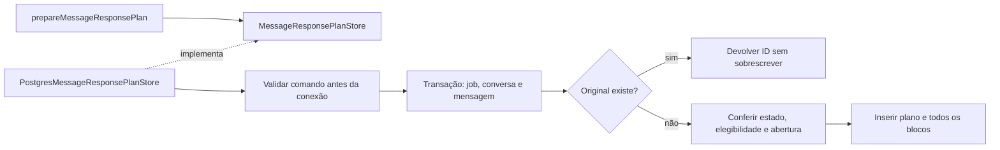

# Etapa 4.19 — Preparação atômica do plano no PostgreSQL

Preparada em 16/11/2026 na branch `feat/postgres-response-plan`, sobre a etapa 4.18 enviada para revisão. Implementa `MessageResponsePlanStore` com um único cliente e transação para proteger a tentativa, reler o contexto e persistir plano/blocos.

**Validação final:** `npm run check` aprovou tipos, compilação e **131 registros sem banco**. `npm run test:integration` aprovou **155 registros**, sem falhas, cancelamentos ou ignorados. São 23 cenários novos e seu agrupador. A suíte nova entrou no script da API; dependências e lockfile não mudaram.

O autor informou que aplicou a migração da etapa 4.18. A conferência inicial encontrou cinco migrações e as duas tabelas novas no banco do projeto. Antes/depois dos testes, contagens e hashes de `contacts`, `conversations`, `messages`, `jobs`, `response_plans`, `response_blocks` e `pgmigrations` permaneceram iguais. Não restaram bancos descartáveis. Nenhuma migração foi executada no banco do projeto nesta etapa.

O Docker foi usado somente para listar o serviço existente, já saudável; não houve reinício ou recriação. A implementação permanece local para revisão, sem commit ou push.

## 1. Fluxo de revisão por dependência

| Ordem | Arquivo | O que revisar |
|---|---|---|
| 1 | [Modelo e regras da etapa 4.17](25-etapa-4-contrato-do-plano-de-resposta.md), seções 4–7, e [migração da etapa 4.18](26-etapa-4-migracao-dos-planos-de-resposta.md) | Relembrar identidade, abertura, unicidades, FKs compostas e diferença entre preparar e enviar. Os textos dessas etapas descrevem o recorte histórico |
| 2 | [message-response-plan.ts](../apps/api/src/modules/messaging/contracts/message-response-plan.ts) e [message-response-plan-store.ts](../apps/api/src/modules/messaging/application/message-response-plan-store.ts) | Schema e resultados existentes. Somente o comentário da porta mudou nesta etapa; nenhuma assinatura ou schema público mudou |
| 3 | [postgres-message-response-plan-store.ts](../apps/api/src/modules/messaging/infrastructure/postgres-message-response-plan-store.ts) | Começar pelo schema de entrada e método `prepare`; depois acompanhar `prepareInTransaction`: locks, vínculos, original, guardas e inserções |
| 4 | [postgres-message-response-plan-store.integration.test.ts](../apps/api/src/modules/messaging/infrastructure/postgres-message-response-plan-store.integration.test.ts) | Primeiro isolamento/fixtures/limpeza; depois persistência e retomada, recusas/adiamento, recuperação, rollback e corridas controladas |
| 5 | [package.json da API](../apps/api/package.json) | Inclusão da nova suíte em `test:integration`; scripts sem banco, dependências e migrações permanecem iguais |
| 6 | READMEs, arquitetura, fluxo, modelagem, contratos, histórico e este guia | Conferir garantias demonstradas, responsabilidades da execução futura e comandos |

O caso de uso [prepare-message-response-plan.ts](../apps/api/src/modules/messaging/application/prepare-message-response-plan.ts) não mudou: continua dependendo da interface, sem importar `pg`. Um cenário de integração conecta o caso de uso, o compositor e o adapter real, com o perfil fictício carregado pelo leitor existente.

## 2. Responsabilidades no monólito modular



O módulo `messaging` continua responsável pelos planos. Sua aplicação usa a porta e o contrato de tentativa de `jobs`; a infraestrutura conhece PostgreSQL e o schema. Não há importação da infraestrutura de `jobs` pelo adapter de produção, nem mudança em `packages/shared`.

O adapter ainda não está conectado à composição da API ou a um worker. Portanto, receber o webhook não passa a criar planos automaticamente.

## 3. Entrada e snapshot

O adapter valida o comando antes de adquirir uma conexão. A tentativa exige UUID e contador inteiro positivo seguro; sua identidade é extraída mesmo quando o chamador fornece um objeto estruturalmente compatível com campos adicionais de reserva. O rascunho usa o schema estrito existente: IDs, estado esperado, ação/próximo estado, data válida e blocos 1…N com texto não vazio. Comando ou rascunho com propriedades desconhecidas é recusado.

Entrada inválida rejeita com `TypeError` e mensagem fixa, sem valores do comando ou detalhes do Zod. O teste confere zero chamadas a `pool.connect()` e ausência de escrita. Falhas de conexão/SQL continuam rejeitando a Promise; não se convertem em sucesso ou ausência de contexto.

O parsing copia os objetos/arrays, e o adapter copia explicitamente a `Date` antes do primeiro `await`. Alterar o comando original durante uma espera não muda os textos, ação ou referência que serão gravados.

Os UUIDs da cópia interna são convertidos para minúsculas antes de comparar os vínculos retornados pelo PostgreSQL. Isso permite receber UUIDs válidos com letras maiúsculas, sem alterar as entradas do chamador; o cenário inicial de persistência cobre essa representação.

Para um plano novo, `referenceAt` precisa corresponder a `messages.created_at` na representação `Date` do Node, em milissegundos. Isso preserva a escolha inicial do expediente: instante persistido da mensagem, não relógio de execução. O PostgreSQL pode armazenar precisão maior; este contrato não promete preservar microssegundos na `Date`.

## 4. Transação e ordem dos bloqueios

1. Abrir `BEGIN ISOLATION LEVEL READ COMMITTED` no cliente adquirido.
2. Bloquear o job por ID com `FOR UPDATE` e conferir `processando + attempts`. Não conferir expiração pelo relógio.
3. Conferir tipo `processar_mensagem` e correspondência entre job e mensagem do rascunho.
4. Bloquear a conversa com `FOR UPDATE`.
5. Ler a mensagem com `FOR SHARE` e conferir sua conversa. O lock também protege alterações de corpo, direção e tipo durante a operação.
6. Consultar o plano existente da mensagem numa instrução posterior ao bloqueio. Conferir seus vínculos com job e conversa e devolver o ID original quando válido.
7. Somente para uma criação: conferir estado, elegibilidade, referência, abertura e outra resposta pendente.
8. Inserir o plano e cada bloco usando o mesmo cliente, e confirmar com `COMMIT` antes de devolver o resultado.

Em `READ COMMITTED`, instruções posteriores enxergam commits concluídos enquanto a transação esperava. Isso permite reconhecer um plano concorrente sem usar uma fotografia feita antes do lock. Uma releitura bloqueante também considera a versão atualizada da linha. Referências: [isolamento](https://www.postgresql.org/docs/18/transaction-iso.html#XACT-READ-COMMITTED) e [bloqueios de linha](https://www.postgresql.org/docs/18/explicit-locking.html#LOCKING-ROWS).

**Ordem a preservar nas futuras operações:** job → conversa → mensagem quando precisarem desses registros juntos. Bloquear a conversa serializa preparações daquela conversa; outras conversas permanecem independentes. As operações futuras que alterarem planos/abertura devem respeitar esse protocolo, além de confirmar seus próprios efeitos atomicamente. Escritas SQL arbitrárias fora dele não recebem a mesma tradução de conflitos da porta; violações inesperadas continuam erros e provocam rollback.

Se houver erro, executar `ROLLBACK` e propagar a falha. Se o rollback também falhar, descartar a conexão em `release(true)`. O teste com trigger exclusivo do banco descartável provoca erro no segundo bloco e comprova que nem plano nem primeiro bloco permanecem; uma repetição válida depois funciona.

## 5. Original, estado e abertura

Uma tentativa inválida não obtém `existente`, mesmo que o plano já esteja gravado. Com tentativa e vínculos válidos, procurar o original antecede os guardas exclusivos de uma nova criação. Assim, nova tentativa do mesmo job ou mudança posterior de estado/perfil não substitui conteúdo, referência, decisão, status ou confirmações. Planos enviados e cancelados também mantêm identidade.

`existente` devolve apenas o ID. Não autoriza envio após intervenção humana, cancelamento ou encerramento; a futura leitura/execução precisa consultar o original e validar suas condições próprias.

Para um plano novo, a conversa deve estar em `aguardando_menu`; a mensagem deve ser uma entrada do contato, de texto, com corpo não vazio. O adapter confere a elegibilidade atual, mas não recompõe o texto nem prova que a decisão recebida corresponda semanticamente ao corpo/perfil atual. O contrato não inclui uma versão do corpo/perfil.

| Situação | Resultado para nova preparação |
|---|---|
| Nenhuma abertura + ação `enviar_abertura` | Pode preparar, desde que não haja outro plano pendente |
| Nenhuma abertura + ação de menu/informações | `contexto_desatualizado` |
| Abertura `pendente`, inclusive envio parcial | `adiado / abertura_pendente` |
| Abertura `cancelado` | `contexto_desatualizado`; não recriar automaticamente |
| Abertura `enviado` + nova ação de abertura | `contexto_desatualizado` |
| Abertura `enviado` + ação de menu/informações | Pode preparar, desde que não haja outro pendente |
| Outra resposta `pendente` | `adiado / resposta_anterior_pendente` |

A leitura usa o status persistido do plano como sinal da abertura. A futura confirmação deverá marcar `enviado` somente após todos os blocos necessários e na mesma transação que mantiver a coerência entre linhas; o SQL da etapa 4.18 não garante sozinho essa equivalência. Os fixtures de abertura enviada criam mensagens de saída e confirmam seus blocos antes de terminar o plano, exclusivamente no banco descartável.

Preparar não altera estado/atividade da conversa, não cria mensagens de saída, não conclui jobs, não incrementa contadores e não define atraso. Adiamento continua sendo um resultado para futura orquestração, sem consumir outra tentativa nesta operação.

## 6. Tentativa e política de 120 segundos

A etapa 4.12 permanece válida: 120 segundos tornam a reserva recuperável, sem revogá-la automaticamente. Se a preparação bloquear primeiro o job, a recuperação com `SKIP LOCKED` o pula. Se a recuperação ou finalização vencer antes, a releitura retorna `reserva_desatualizada`.

Depois de recuperar e reservar novamente, o novo contador pode reconhecer o mesmo plano; o antigo não pode criar nem reconhecer o plano como tentativa válida. A identidade durável pertence à mensagem, não ao número da tentativa. Nenhuma política de retry, recuperação, `complete()` ou `fail()` foi modificada.

## 7. Testes e limites demonstrados

Os 23 cenários cobrem:

- Snapshot persistido completo e origens/job/conversa preservados.
- Caso de uso/compositor com adapter real e perfil alterado na retomada.
- Original reconhecido após avanço de estado e após envio/cancelamento.
- Entrada inválida antes da conexão; contadores, vínculos e tipo do job.
- Estados não elegíveis, direção/remetente/mídia/corpo e referência temporal.
- Abertura inexistente, pendente, parcial, enviada e cancelada; três ações de menu.
- Resposta anterior pendente e liberação após envio/cancelamento.
- Expiração isolada, recuperação antes/depois da preparação e nova reserva.
- Rollback integral quando o segundo bloco falha.
- Chamadas da mesma origem, duas aberturas e menus concorrentes.
- Independência entre conversas e releituras de estado, job e mensagem depois de mudanças concorrentes.
- Preservação do comando quando o chamador o altera durante a espera.

As corridas controladas usam uma conexão que bloqueia a conversa/job. A suíte observa `pg_blocking_pids` com uma CTE recursiva para reconhecer bloqueios diretos e indiretos antes de liberar o competidor. Não há `sleep`, `setTimeout` ou aumento do timeout da aplicação. A observação tem número máximo de consultas e a suíte tem prazo de 60 segundos.

Na primeira execução completa, dois cenários novos atingiram o timeout porque a barreira inicial só contava bloqueios diretos. A barreira foi corrigida para seguir a cadeia; a suíte nova isolada passou e a execução final completa aprovou todos os 155 registros. O problema foi corrigido no teste, sem aumentar o timeout do pool.

Uma das execuções completas aprovadas também emitiu o aviso genérico existente `Uma conexão ociosa com o PostgreSQL foi interrompida.` na suíte de recuperação, que terminou aprovada. O listener do pool descarta a conexão ociosa e registra essa mensagem; ele não registra o erro original, portanto não há evidência para atribuir uma causa específica. Nenhum diagnóstico ou alteração desse listener foi incluído nesta entrega.

Cada execução da suíte cria somente seu banco `copilot_plan_store_test_<UUID>` a partir de `template0`, migra nele, limpa suas tabelas entre cenários e fecha o cliente do migrador/pool antes de remover o banco. O banco configurado no `.env` fornece acesso administrativo local, mas não recebe fixtures, migrações ou limpezas.

## 8. Comandos para revisão

Na raiz, com PostgreSQL local disponível:

```powershell
npm run check
npm run test:integration
```

Resultados finais: **131 sem banco e 155 de integração**, tipos e compilação aprovados. Para somente a nova suíte, são 23 cenários mais seu agrupador:

```powershell
npm run build --workspace=@copilot-leads/api
node --env-file=.env --test apps/api/dist/modules/messaging/infrastructure/postgres-message-response-plan-store.integration.test.js
```

Não é necessário iniciar a API, enviar mensagens pelo Postman ou executar `npm run db:migrate` nesta etapa: nenhuma migração nova foi criada. Para consultar o Docker, usar `docker compose ps`; se o serviço estiver parado, o comando conhecido é `docker compose up -d --wait --wait-timeout 120 postgres`.

## 9. Próximo recorte

Proposta: contrato e leitura do plano original com seus blocos e progresso, para permitir uma retomada baseada no conteúdo persistido em vez de recomposição. A leitura deverá preservar ordem, datas e campos de confirmação, distinguir ausência de falha e validar a representação sem autorizar envio.

Continuam para entregas próprias: confirmação/cancelamento de blocos, transições coordenadas, ordenação entre mensagens, adiamento sem gasto indevido de tentativas, adapter de saída e worker. Um pendente por conversa não garante FIFO de jobs ainda não preparados, e unicidade/checkpoints locais não garantem entrega externa exatamente uma vez. Nenhuma IA foi selecionada ou integrada aqui.
