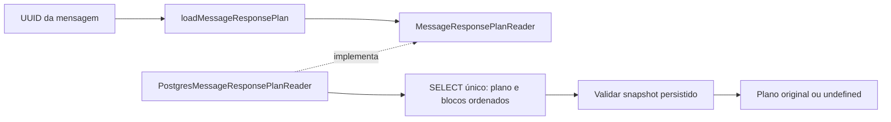

# Etapa 4.20 — Leitura do plano de resposta persistido

Preparada em 16/11/2026 na branch `feat/response-plan-reader`, sobre `docs/response-plans-dbml`. Inclui a preparação PostgreSQL da etapa 4.19 já enviada e a correção documental do DBML. Este recorte lê o plano original com seus blocos e confirmações, sem recompor os textos.

**Validação executada:** `npm run check` aprovou tipos, compilação e **144 registros sem banco**. `npm run test:integration` aprovou **169 registros**, sem falhas, cancelamentos ou ignorados. São dez testes novos de contrato, três de aplicação e 13 cenários de integração mais seu agrupador.

Contagens e hashes de `contacts`, `conversations`, `messages`, `jobs`, `response_plans`, `response_blocks` e `pgmigrations` permaneceram iguais no banco do projeto. Não restaram bancos descartáveis. O PostgreSQL do Docker já estava saudável; foi apenas consultado, sem reinício ou recriação. Nenhuma migração, dependência ou credencial mudou. As alterações ficam locais para revisão, sem commit ou push.

## 1. Problema e responsabilidade

A preparação devolve `planId`, mas uma retomada precisa dos textos e checkpoints efetivamente gravados. Recalcular o perfil, a decisão ou os horários não recupera o conteúdo original. A leitura oferece esse conteúdo e distingue ausência, falha de infraestrutura e representação persistida inválida.

A busca usa o **UUID interno da mensagem de origem**, pois `source_message_id` identifica no máximo um plano em todos os estados. Isso permite ao futuro processador procurar o original antes de decidir ou recompor. Não há fallback para o plano mais recente da conversa ou contato. Não foi acrescentada outra busca por ID do plano neste recorte.



No monólito modular, `messaging/application` depende da porta e do contrato interno; não conhece `pg`, SQL ou migrações. A infraestrutura implementa a consulta e valida sua representação. O schema de leitura reutiliza campos do schema de criação, sem alterar o rascunho ou o store. `packages/shared` permanece inalterado, pois não há contrato HTTP ou do painel nesta entrega.

## 2. Fluxo de revisão por dependência

Os caminhos abaixo pertencem a `apps/api/src/modules/messaging`, salvo indicação contrária.

| Ordem | Arquivo | Responsabilidade e pontos de atenção |
|---|---|---|
| 1 | [message-response-plan.ts](../apps/api/src/modules/messaging/contracts/message-response-plan.ts) e [migração existente](../apps/api/migrations/1794787200000_create_response_plans.sql) | Relembrar o rascunho, identidade e colunas persistidas. Estes arquivos não mudaram |
| 2 | [message-response-plan-snapshot.ts](../apps/api/src/modules/messaging/contracts/message-response-plan-snapshot.ts) | Modelo de leitura: identidade, decisão original, datas, status e confirmações. Conferir as regras entre linhas que o SQL isolado não garante |
| 3 | [message-response-plan-snapshot.test.ts](../apps/api/src/modules/messaging/contracts/message-response-plan-snapshot.test.ts) | Dez testes de estrutura, preservação, datas, posições e coerência de progresso |
| 4 | [message-response-plan-reader.ts](../apps/api/src/modules/messaging/application/message-response-plan-reader.ts) | Porta: mensagem de origem, resultado opcional, propagação de falhas e limites da fotografia |
| 5 | [load-message-response-plan.ts](../apps/api/src/modules/messaging/application/load-message-response-plan.ts) e [seus testes](../apps/api/src/modules/messaging/application/load-message-response-plan.test.ts) | Caso de uso delega à porta e preserva resultado/ausência/falha, sem consultar perfil ou decidir efeitos |
| 6 | [postgres-message-response-plan-reader.ts](../apps/api/src/modules/messaging/infrastructure/postgres-message-response-plan-reader.ts) | UUID antes do SQL, parâmetros, LEFT JOIN, ordenação, mapeamento de datas e validação final |
| 7 | [postgres-message-response-plan-reader.integration.test.ts](../apps/api/src/modules/messaging/infrastructure/postgres-message-response-plan-reader.integration.test.ts) | Começar pelo banco descartável/fixtures/limpeza; depois dados originais, progresso, histórico, recusas e leitura durante confirmação concorrente |
| 8 | [package.json da API](../apps/api/package.json) | Inclusão das duas suítes sem banco e da suíte de integração, sem dependências novas |
| 9 | READMEs, arquitetura, fluxo, modelagem, contratos, histórico e este guia | Conferir responsabilidades atuais, regras de coerência e o que permanece para o executor |

## 3. Contrato de leitura e coerência

`MessageResponsePlanSnapshot` é separado de `MessageResponsePlanDraft`: um representa dados persistidos e progresso; o outro representa a intenção a criar.

| Campos | Significado |
|---|---|
| `id`, `messageId`, `conversationId`, `sourceJobId` | UUIDs persistidos do plano e suas origens |
| `expectedStatus`, `decision` | Estado esperado e ação/próximo estado originais; não representam o estado atual da conversa |
| `referenceAt`, `createdAt`, `finishedAt` | Referência original do expediente, criação e término; datas `Date`, sem coerção de strings ou uso do relógio |
| `status` | `pendente`, `enviado` ou `cancelado` |
| `blocks` | Lista não vazia, ordenada e consecutiva de 1 até N, com textos preservados |
| `blocks[].status`, `sentMessageId`, `sentAt` | Progresso e confirmação de cada bloco; não se inferem do status da conversa |

O contrato é estrito em todos os objetos e deriva os tipos do Zod. IDs/datas inválidos, textos vazios, posições repetidas/fora de ordem/lacunas e propriedades desconhecidas são recusados. Textos não são aparados, referência não é atualizada e não se consulta o perfil. Uma confirmação não pode aparecer em dois blocos do mesmo snapshot.

As regras de representação do progresso são:

| Estado | Exigência |
|---|---|
| Bloco `pendente` ou `cancelado` | `sentMessageId` e `sentAt` nulos |
| Bloco `enviado` | UUID de confirmação e `Date` válida obrigatórios |
| Plano `pendente` | `finishedAt` nulo; blocos pendentes/enviados, sem cancelados |
| Plano `enviado` | `finishedAt` obrigatório e todos os blocos enviados |
| Plano `cancelado` | `finishedAt` obrigatório; blocos enviados/cancelados, sem pendentes |
| Plano terminado | Término não anterior à criação |

Essas verificações entre plano/blocos são guardas de leitura, não novas constraints ou operações de confirmação. O SQL atual admite algumas incoerências entre linhas; o leitor as rejeita com erro fixo e **não corrige o banco**. A futura confirmação deverá manter a representação coerente atomicamente.

Um plano ainda `pendente` com todos os blocos confirmados é representável: ler confirmações não autoriza concluir automaticamente o plano, avançar a conversa ou reenviar. A finalização coordenada será definida na entrega própria. O contrato também não escolhe o próximo bloco nem impõe uma nova política de ordem de envio ou relações temporais entre confirmações; posições continuam determinando a ordem textual do plano.

## 4. Consulta e erros

O adapter valida o UUID antes da consulta, com `TypeError` de mensagem fixa e sem o valor recebido. UUIDs com letras maiúsculas são aceitos pelo parâmetro PostgreSQL; os IDs retornados preservam a representação do banco.

Uma única instrução seleciona o plano por `source_message_id` e seus blocos, com `ORDER BY block.position`. O `LEFT JOIN` mantém a linha do plano mesmo quando não existem blocos. Assim:

- Nenhum plano: `undefined`, inclusive se a mensagem existe sem plano.
- Plano sem blocos ou com representação inválida: rejeição `O plano de resposta persistido é inválido.`, sem textos ou detalhes do Zod.
- Falha SQL/conexão: rejeição propagada, sem conversão para ausência ou fallback.

Datas PostgreSQL são recebidas pelo `pg` como `Date`; a precisão disponibilizada neste contrato é de milissegundos, sem promessa de preservar microssegundos. A seleção não carrega `raw_payload`, corpo da mensagem de origem, histórico ou perfil do negócio.

O SELECT único compartilha uma fotografia confirmada para cabeçalho e blocos. Isso evita misturar resultados de duas consultas separadas enquanto uma confirmação concorrente termina. O teste mantém uma atualização completa ainda sem commit: a leitura preserva a versão anterior e, após o commit, reflete o plano enviado com todos os blocos. Não usa timers ou espera artificial. Referência: [isolamento Read Committed do PostgreSQL](https://www.postgresql.org/docs/18/transaction-iso.html#XACT-READ-COMMITTED).

**Uma fotografia válida não autoriza efeitos.** Não há reserva do job, `FOR UPDATE`, validação de tentativa atual, trava da conversa, transição, escolha de envio ou gravação. O leitor aceita planos enviados/cancelados e conversas em qualquer estado, inclusive encerradas, porque a consulta também serve à retomada/auditoria. Antes de qualquer efeito futuro, será necessário revalidar tentativa, conversa e progresso na operação protegida correspondente.

## 5. Testes e isolamento

Os dez testes de contrato verificam estrutura/identidade, datas, decisões textuais, blocos, confirmações, término, progresso parcial/terminal e confirmação duplicada. Os três testes do caso de uso verificam delegação, ausência e propagação de falha.

Os 13 cenários PostgreSQL verificam:

1. Mensagem inexistente e mensagem existente sem plano.
2. Snapshot completo, UUID com maiúsculas, ordem física diferente, textos/datas e banco preservados.
3. Progresso parcial com confirmação original.
4. Plano enviado, job concluído e os seis estados atuais da conversa.
5. Cancelamento total/parcial sem apagar confirmações anteriores.
6. Plano histórico após abertura de outro ciclo no mesmo contato.
7. Três ações de menu sem substituir a abertura.
8. Independência das leituras e preservação do banco após alterar o objeto retornado.
9. Plano sem blocos ou com lacuna: inválido, não inexistente.
10. Incoerência entre estado do plano e blocos, sem reparo automático.
11. UUID inválido antes do SQL e erro sem valor recebido.
12. Versão confirmada antes/depois de confirmação concorrente de plano/blocos.
13. Falha SQL propagada e leitura válida após restaurar a relação de teste.

Cada execução cria seu banco `copilot_plan_read_test_<UUID>` a partir de `template0`. As migrações, fixtures, confirmações sintéticas, limpeza por `TRUNCATE` e renomeação temporária de relação para provocar falha SQL ocorrem **somente nesse banco**. O cliente do migrador e o pool são fechados antes de removê-lo. Nenhum teste executa scripts de migração no banco do projeto.

A suíte existente de reivindicação emitiu `Uma conexão ociosa com o PostgreSQL foi interrompida.` e terminou aprovada. O listener atual não registra a causa original; não há evidência para atribuí-la a uma causa específica. Não foi alterado esse listener. A validação completa terminou com todos os 169 registros aprovados.

## 6. Comandos de revisão

Na raiz, com PostgreSQL local disponível para integração:

```powershell
npm run check
npm run test:integration
```

Resultados observados: **144 sem banco e 169 de integração**, tipos e compilação aprovados. Para somente os arquivos novos:

```powershell
npm run build --workspace=@copilot-leads/api
node --test apps/api/dist/modules/messaging/contracts/message-response-plan-snapshot.test.js apps/api/dist/modules/messaging/application/load-message-response-plan.test.js
node --env-file=.env --test apps/api/dist/modules/messaging/infrastructure/postgres-message-response-plan-reader.integration.test.js
```

Não precisa iniciar a API ou usar Postman: nenhum endpoint novo foi criado. Não há nova migração para executar com `db:migrate`.

## 7. Próximo recorte proposto

Definir a confirmação persistida dos blocos, com contrato/caso de uso e operação PostgreSQL protegida. Será necessário decidir sua coordenação com mensagens de saída, estado da conversa e término do plano, preservando tentativas, ordem e idempotência local. Adapter de envio, cancelamento, política de ordenação entre mensagens, adiamento e worker continuam para suas entregas próprias. Nenhuma integração de IA foi acrescentada.
